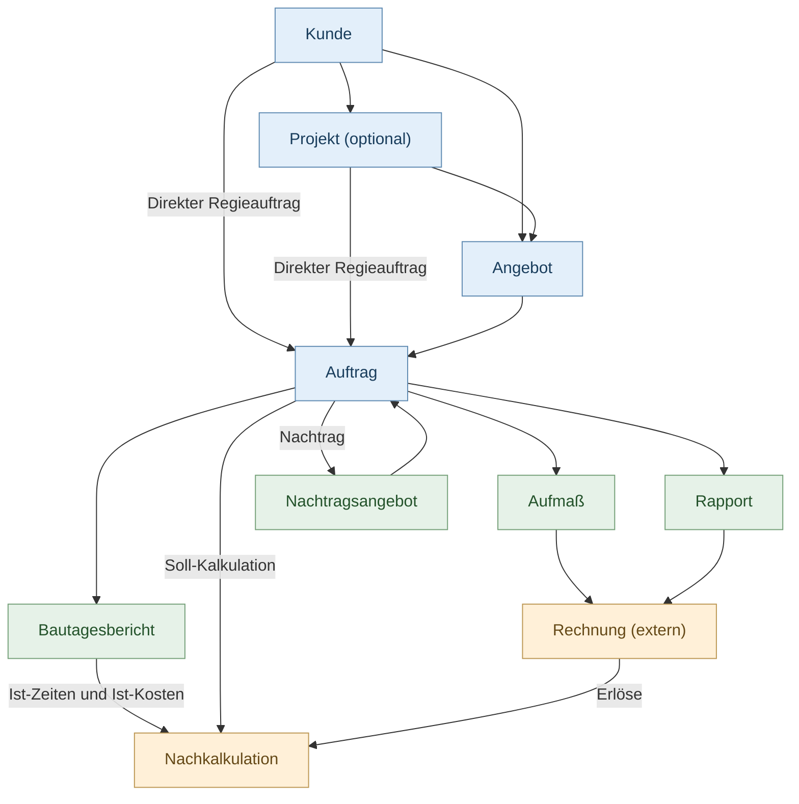
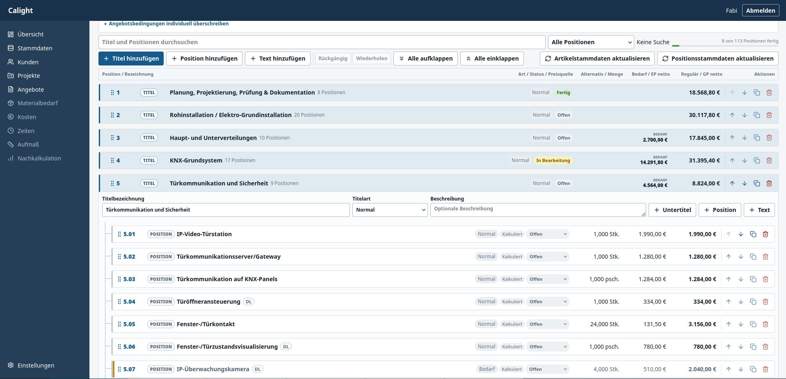
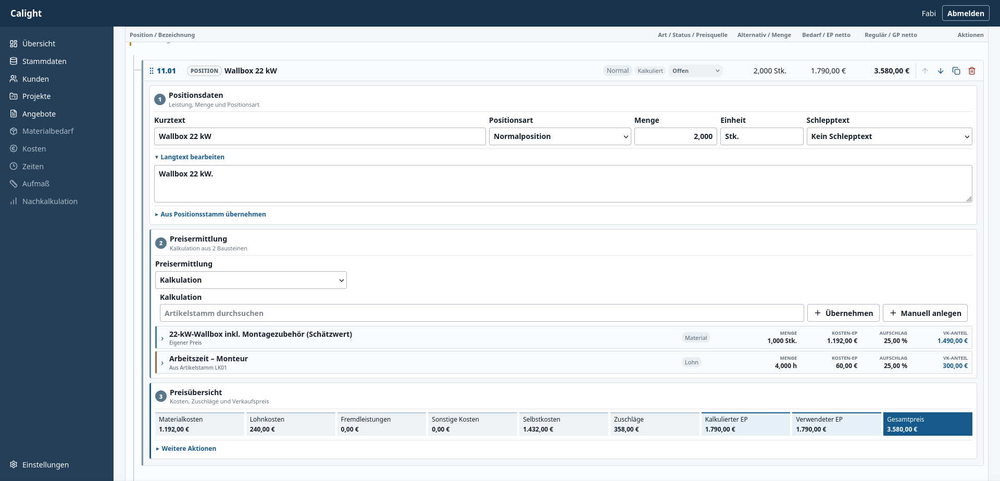
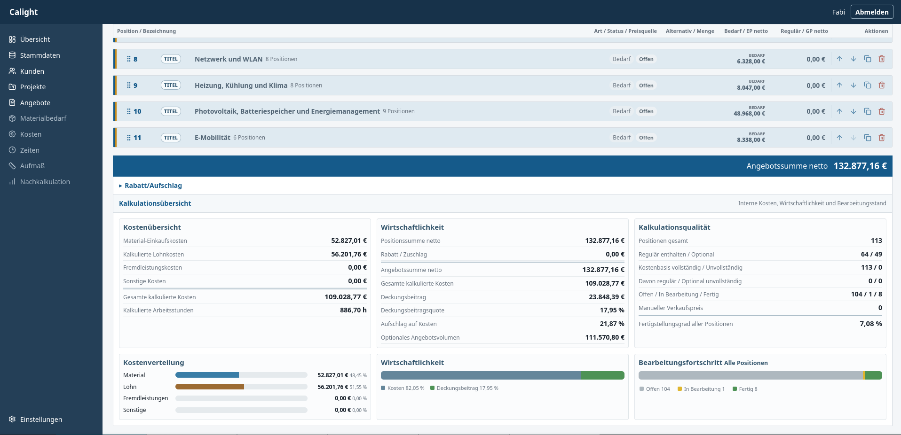

# Calight

**Open-Source-Software für Angebots- und Auftragsabwicklung im Handwerk und Dienstleistungsbereich.**

Calight ist eine schlanke, selbst gehostete Webanwendung zur Erstellung, Kalkulation und Verwaltung von Angeboten. Sie richtet sich an Handwerksbetriebe, Einzelunternehmer und Dienstleister, die ihre Leistungen transparent und nachvollziehbar kalkulieren möchten.

Der Fokus liegt auf einer übersichtlichen Bedienung, detaillierter Kalkulation und möglichst geringer technischer Komplexität.

> **Entwicklungsstatus:** Calight befindet sich in aktiver Entwicklung. Die Anwendung ist noch nicht als vollständig produktionsreife Software einzustufen. Funktionen können sich ändern, und Fehler sind möglich.

## Funktionen

### Angebotsverwaltung
- Angebote mit beliebig verschachtelten Titeln und Positionen
- Normal-, Bedarfs-, Alternativ- und Textpositionen
- Angebotsnummern und Angebotsstatus
- Angebotsprüfung vor der Abgabe
- Unveränderliche Archivierung abgegebener Angebote
- PDF-Ausgabe und JSON-Import/-Export

### Kalkulation
- Kalkulation von Material, Lohn, Fremdleistungen und sonstigen Kosten
- Einkaufspreise, Aufschläge und Verkaufspreise
- Manuelle Verkaufspreise bei weiterhin nachvollziehbarer Kalkulation
- Artikel- und Positionsstamm
- Wiederverwendbare Kalkulationsbausteine
- Interne Kalkulationsübersicht und detaillierte Kalkulations-PDF

### Stammdaten
- Kundenverwaltung
- Projektverwaltung
- Artikel- und Positionsstamm
- Lohnkostengruppen

Die derzeitige Projektzuordnung bei Angeboten soll künftig optional werden.

## Auftragsabwicklung

Langfristig soll Calight nicht nur Angebote kalkulieren, sondern auch deren anschließende Ausführung und wirtschaftliche Auswertung begleiten.

Dabei werden zwei grundlegende Abläufe unterstützt:

- **Angebotsarbeiten:** Angebot → Auftrag → Aufmaß → Abrechnung
- **Regiearbeiten:** Direkter Auftrag → Rapport → Abrechnung

Bautagesberichte dienen der internen Dokumentation und Ist-Kostenerfassung. Die Nachkalkulation stellt kalkulierte beziehungsweise abrechenbare Leistungen den tatsächlich entstandenen Kosten gegenüber.

### Geplanter Geschäftsprozess



Projekte sind dabei eine optionale organisatorische Zusammenfassung mehrerer Angebote und Aufträge. Einfache Angebote und Regieaufträge sollen auch ohne Projekt möglich sein.

Aufmaße und Rapporte sind eigenständige Leistungsnachweise. Bautagesberichte sind davon unabhängig und dokumentieren die tatsächliche Ausführung.

## Roadmap

Die folgenden Funktionen sind geplant und teilweise noch nicht implementiert.

| Phase | Geplante Funktionen | Status |
|---|---|---|
| 0 | Technische Grundlagen, Anmeldung, Datenbankmigrationen | Abgeschlossen |
| 1 | Stammdaten, Artikel- und Positionsstamm | Abgeschlossen |
| 2.1–2.3 | Angebotseditor, Kalkulation, PDF und JSON | Abgeschlossen |
| 2.4 | Angebotsabgabe, Prüfung, Archivierung und Statusverwaltung | Implementiert, weitere Tests ausstehend |
| 2.5 | Angebotsrevisionen und Nachträge | Geplant |
| 3.1 | Auftragsverwaltung, optionale Projekte und direkte Regieaufträge | Geplant |
| 3.2 | Bautagesberichte, Zeit- und Materialerfassung | Geplant |
| 3.3 | Aufmaße für Angebotsarbeiten | Geplant |
| 3.4 | Rapporte für Regiearbeiten | Geplant |
| 3.5 | Nachkalkulation und Soll-Ist-Vergleich | Geplant |
| 3.6 | Abrechnungstracking | Geplant |
| 4.1 | Ansprechpartnerverwaltung | Geplant |
| 4.2 | CardDAV-Adressbücher lesend integrieren | Geplant |
| 4.3 | Kontakte übernehmen und Kundendaten manuell aktualisieren | Geplant |
| 4.4 | Kontakte direkt über CardDAV bearbeiten | Optional |

Die Reihenfolge und der Funktionsumfang können sich während der Entwicklung ändern.

Weitere technische und fachliche Details sind in [ROADMAP.md](ROADMAP.md) dokumentiert.

## Keine Buchhaltungssoftware

Calight konzentriert sich auf Kalkulation, Angebotserstellung und perspektivisch die Auftragsabwicklung.

Die Software soll bestehende Rechnungs- und Buchhaltungsprogramme wie Lexware ergänzen, nicht ersetzen.

Rechnungen werden weiterhin extern erstellt. Geplant ist lediglich die Möglichkeit, Rechnungsdaten und Abrechnungsstände innerhalb der Auftragsverwaltung nachzuhalten.

## Technik

| Bereich | Technologie |
|---|---|
| Backend | PHP |
| Webserver | Apache |
| Datenbank | SQLite |
| Frontend | HTML, CSS, Vanilla JavaScript |
| PDF-Erzeugung | Projekteigene PDF-Infrastruktur (`SimplePdf`) |
| Angebotsdaten | JSON |
| Bereitstellung | Docker / Self-Hosting |
| Lizenz | AGPL-3.0 |

Calight setzt bewusst auf einen einfachen, wartbaren Technologie-Stack ohne umfangreiche Frontend-Frameworks oder Microservice-Architektur.

Die Anwendung ist für den eigenständigen Betrieb auf einem Server oder NAS konzipiert. Eine externe Cloud ist nicht erforderlich.

### Voraussetzungen

- Docker mit Docker Compose oder PHP 8.4 mit Apache
- PHP-Erweiterungen `iconv`, `json`, `mbstring`, `PDO` und `pdo_sqlite`
- Composer 2 für eine Installation ohne Docker
- Schreibbarer, dauerhaft gesicherter Datenpfad für SQLite, Angebots-JSON, Dokumente und Vorlagen

Calight verwendet derzeit **nicht mPDF**, sondern die im Projekt enthaltene PDF-Implementierung `SimplePdf`. `iconv` ist für Dateinamen und PDF-Texte zwingend erforderlich.

### Installation mit Docker

```bash
cp .env.example .env
docker compose build
docker compose up -d
docker compose exec calight php bin/console migrate
docker compose exec calight php bin/console user:create admin "Administrator"
```

Die Anwendung ist anschließend standardmäßig unter `http://localhost:8085` erreichbar. Anwendungsdaten liegen im benannten Docker-Volume `calight-data`. Vor Updates sollte dieses Volume gesichert werden.

Für den Betrieb hinter HTTPS muss `APP_SECURE_COOKIES=1` in der lokalen, von Git ignorierten `.env` gesetzt werden. Dort kann bei Bedarf auch der Host-Port über `CALIGHT_PORT` geändert werden. Zugangsdaten gehören nicht in Compose-Dateien oder das Git-Repository.

### Installation ohne Docker

Der Document-Root des Webservers muss auf `app/public` zeigen. Anschließend:

```bash
cd app
composer install --no-dev --classmap-authoritative
export APP_DATABASE_PATH=/absoluter/pfad/database/app.sqlite
export APP_OFFERS_PATH=/absoluter/pfad/offers
export APP_DOCUMENTS_PATH=/absoluter/pfad/documents
export APP_TEMPLATES_PATH=/absoluter/pfad/templates
php bin/console migrate
php bin/console user:create admin "Administrator"
```

Optional kann beim Anlegen eines Kontos eine feste Rolle angegeben werden:

```bash
php bin/console user:create buero "Büro" office
php bin/console user:create monteur "Monteur" technician
```

Die Rollen `admin`, `office` und `technician` verwenden feste Berechtigungsgruppen. Bestehende Konten werden bei der zugehörigen Migration als Administratoren übernommen. Benutzerstatus und Rolle können ohne zusätzliche Verwaltungsoberfläche über die geschützte Benutzer-API verwaltet werden.

Alle konfigurierten Verzeichnisse müssen für den Webserver-Benutzer schreibbar sein. Im produktiven Betrieb sind HTTPS, sichere Cookies, regelmäßige Backups und restriktive Dateiberechtigungen erforderlich.

### Tests

Die Tests verwenden ausschließlich temporäre, isolierte SQLite-Datenbanken und verändern weder die konfigurierte Produktivdatenbank noch bestehende Angebotsdateien.

```bash
cd app
composer install
composer validate --strict
composer test
```

PHP-Syntax und JavaScript-Syntax können zusätzlich geprüft werden:

```bash
find app -path app/vendor -prune -o -name '*.php' -print0 | xargs -0 -n1 php -l
find app/public/assets -name '*.js' -print0 | xargs -0 -n1 node --check
```

Dieselben Prüfungen laufen über den GitHub-Actions-Workflow `Quality`.

## Entwicklung

Calight ist ein **Vibe-Coding-Projekt**, das überwiegend mithilfe von OpenAI Codex und GPT-5.6 entwickelt wird.

Die fachliche Konzeption basiert auf praktischen Anforderungen aus dem Elektrohandwerk und der Gebäudeautomation.

Ziel ist eine möglichst unkomplizierte Anwendung, die typische Abläufe kleiner Handwerksbetriebe abbildet, ohne den Funktionsumfang einer vollständigen ERP-Software anzustreben.

Beiträge, Fehlermeldungen und Verbesserungsvorschläge sind willkommen.

## Lizenz

Calight ist freie Open-Source-Software unter der **GNU Affero General Public License v3.0 (AGPL-3.0)**.

Die Software darf auch kommerziell kostenlos genutzt, verändert und weitergegeben werden. Dabei gelten die Bedingungen der AGPL-3.0.

Siehe [LICENSE](LICENSE).

## Screenshots

### Angebotseditor – Titel und Positionen



### Angebotseditor – Positionskalkulation



### Angebotseditor – Kalkulationsübersicht


