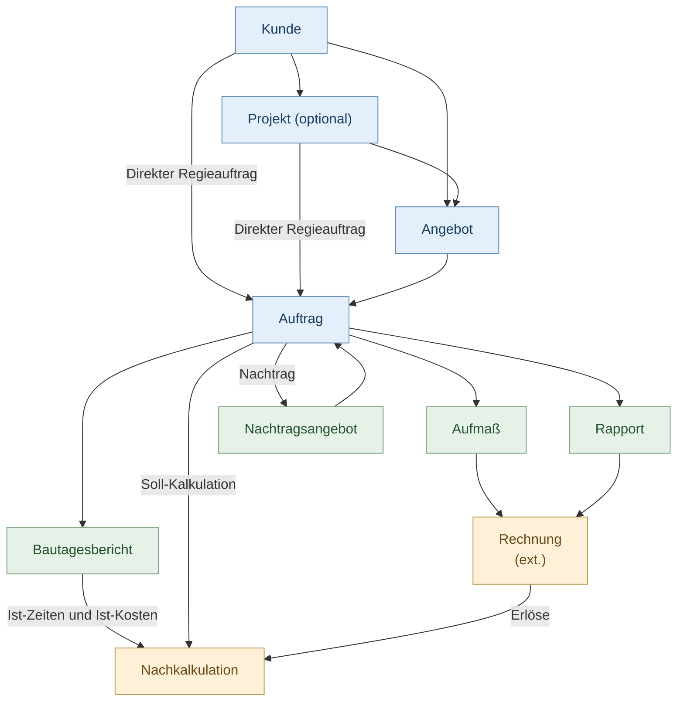

# Calight

**Open-Source-Kalkulations- und Angebotssoftware für Handwerk und Dienstleistung.**

Calight ist eine schlanke, selbst gehostete Anwendung zur Erstellung und Kalkulation von Angeboten. Sie richtet sich an Handwerksbetriebe, Einzelunternehmer und Dienstleister, die ihre Leistungen transparent und detailliert kalkulieren möchten.

## Funktionen

- Angebote mit verschachtelten Titeln und Positionen
- Artikel- und Positionsstamm
- Kalkulation von Material, Lohn, Fremdleistungen und sonstigen Kosten
- Einkaufspreise, Aufschläge und Verkaufspreise
- Kunden- und Projektverwaltung
- Bedarfs- und Alternativpositionen
- Interne Kalkulationsübersicht
- PDF-Ausgabe und JSON-Import/-Export

## Keine Buchhaltungssoftware

Calight konzentriert sich auf **Kalkulation und Angebotserstellung**. Es soll Buchhaltungs- und Rechnungssoftware wie Lexware ergänzen, nicht ersetzen.

## Auftragsabwicklung

## Technik

- PHP, Apache und SQLite
- HTML, CSS und Vanilla JavaScript
- Docker / Self-Hosting
- Keine Cloud erforderlich

## Entwicklung

Calight ist ein **Vibe-Coding-Projekt**, das überwiegend mit **OpenAI Codex und GPT-5.6** entwickelt wird. Die fachliche Konzeption basiert auf praktischen Anforderungen aus dem Elektrohandwerk.

Das Projekt befindet sich in aktiver Entwicklung. Änderungen und Fehler sind möglich.

## Lizenz

Calight ist freie Open-Source-Software unter der **GNU Affero General Public License v3.0 (AGPL-3.0)**.

Die Software darf auch kommerziell kostenlos genutzt, verändert und weitergegeben werden. Dabei gelten die Bedingungen der AGPL-3.0.

Siehe [LICENSE](LICENSE).

## Bilder

Calight Angebotseditor Titel / Positionen

Calight Angebotseditor Positionskalkulation

Calight Angebotseditor Kalkulationsübersicht