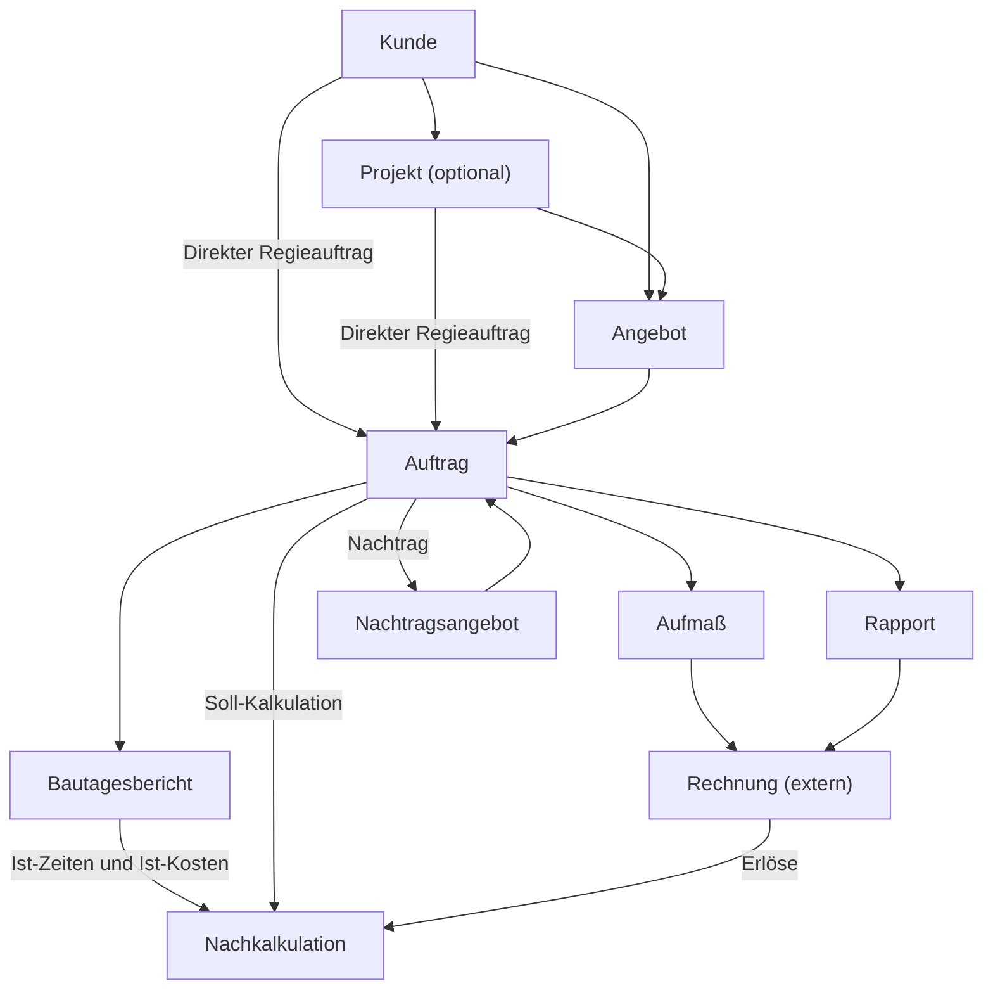

# Calight – Entwicklungsroadmap

**Stand:** 09.11.2026  
**Status:** Fachliche Zielplanung. Noch nicht implementierte Funktionen sind ausdrücklich als geplant gekennzeichnet.

Calight ist eine schlanke, selbst gehostete Anwendung für **Angebots- und Auftragsabwicklung im Handwerk und Dienstleistungsbereich**. Sie unterstützt die Kalkulation und soll künftig die Ausführung, Leistungsnachweise und Nachkalkulation begleiten. Rechnungsstellung und Buchhaltung bleiben in externen Anwendungen wie Lexware.

> Diese Roadmap ist ein Planungsdokument und keine Zusage bestimmter Veröffentlichungstermine. Der öffentlich sichtbare GitHub-Stand kann gegenüber lokalen Entwicklungsständen zurückliegen.

## Überblick

| Phase | Inhalt | Status |
|---|---|---|
| 0 | Technische Grundlagen, Anmeldung, Migrationen | Abgeschlossen laut Entwicklungsstand |
| 1 | Kunden, Projekte, Artikel- und Positionsstamm | Abgeschlossen laut Entwicklungsstand |
| 2.1–2.3 | Angebotseditor, Kalkulation, PDF und JSON | Abgeschlossen laut Entwicklungsstand |
| 2.4 | Angebotsabgabe, Validierung, Snapshot, archivierte PDF, Status | Implementiert; Integrationstests teilweise ausstehend |
| 2.5 | Angebotsrevisionen und Nachträge | Geplant |
| 3.1 | Auftragsverwaltung, projektfreie Angebote, direkte Regieaufträge | Geplant |
| 3.2 | Bautagesberichte und interne Ist-Erfassung | Geplant |
| 3.3 | Aufmaße für vereinbarte Angebotsleistungen | Geplant |
| 3.4 | Rapporte für Regieleistungen | Geplant |
| 3.5 | Nachkalkulation und Soll-Ist-Vergleich | Geplant |
| 3.6 | Abrechnungstracking, ohne Rechnungsstellung | Geplant |
| 4.1 | Ansprechpartnerverwaltung | Geplant |
| 4.2 | CardDAV-Adressbücher lesend anbinden | Geplant |
| 4.3 | Kontaktübernahme und manuelle Aktualisierung | Geplant |
| 4.4 | Direktes Schreiben auf CardDAV-Server | Optional |

## Fachliche Grundregeln

- **Kunde:** Eigenständiger Geschäftspartner mit vollständig gespeicherten Stammdaten in SQLite.
- **Projekt:** Optionale organisatorische Klammer für mehrere Angebote und Aufträge eines Kunden. Einfache Vorgänge benötigen kein Projekt.
- **Angebot:** Kalkulierte, angebotene Leistungen. Die konkret abgegebene Fassung bleibt unveränderlich.
- **Auftrag:** Eigenständiger Vorgang zur Ausführung. Entsteht aus einem angenommenen Angebot **oder direkt ohne Angebot** als Regieauftrag.
- **Bautagesbericht:** Tagesdokumentation tatsächlicher Tätigkeiten, Zeiten und Aufwendungen; kein Abrechnungsnachweis.
- **Aufmaß:** Nachweis ausgeführter Mengen zu vereinbarten Angebotspositionen.
- **Rapport:** Nachweis abrechenbarer Regieleistungen, typischerweise Stunden, Material und Anfahrt.
- **Nachkalkulation:** Wirtschaftliche Auswertung von Soll-Leistungen, Ist-Kosten und Erlösen.
- **Abrechnung:** Rechnungen werden extern erstellt. Calight bildet nur Referenzen und Abrechnungsstände ab.

### Geplanter Geschäftsprozess

Aufmaße, Rapporte und Bautagesberichte sind **unabhängig** voneinander. Innerhalb eines Auftrags können Aufmaße und Rapporte nebeneinander vorkommen. Die Nachkalkulation kann bereits während der Ausführung erfolgen, nicht erst nach der Schlussrechnung.

## Phase 2.5 – Angebotsrevisionen und Nachträge

### Angebotsrevisionen

- Abgegebene Angebotsfassungen niemals direkt bearbeiten.
- Neue, bearbeitbare Revision mit gleicher Angebotsnummer und fortlaufender Revisionsnummer erstellen.
- Jede abgegebene Revision erhält ihren eigenen unveränderlichen Snapshot und ein archiviertes PDF.
- Vorherige Fassungen und Revisionshistorie erhalten; Revision 0 nicht eigens als „Revision 0“ anzeigen.
- Eindeutig speichern, welche Angebotsrevision tatsächlich angenommen wurde.
- Statusübergänge, Ersetzung vorheriger Revisionen und Umgang mit mehrfacher Annahme vor Umsetzung verbindlich festlegen.

### Nachträge

- Ein Nachtrag beschreibt zusätzliche oder geänderte Leistungen **zu einem bestehenden Auftrag**; er ist nicht bloß eine neue Angebotsrevision.
- Nachträge separat kalkulieren und dem Auftrag zuordnen.
- Erst nach Annahme in den verbindlichen Leistungsumfang und die Soll-Kalkulation übernehmen.
- Originalangebot, ursprünglicher Leistungsumfang und Nachtragshistorie bleiben nachvollziehbar.
- Bestehende Kalkulations- und Angebotslogik wiederverwenden; keine zweite Kalkulationsengine schaffen.

## Phase 3.1 – Auftragsverwaltung und optionale Projekte

### Projekte werden optional

Derzeit ist für neue Angebote noch ein Projekt erforderlich. Diese Pflicht soll entfallen.

- **Kunde ist Pflicht, Projekt ist optional** bei neuen Angeboten.
- Angebote ohne Projekt erstellen, verwalten, abgeben und bei Bedarf später einem Projekt zuordnen, ohne abgegebene Dokumente nachträglich zu verändern.
- Keine automatisch angelegten Dummy-/Standardprojekte.
- Bestehende Projekt- und Angebotszuordnungen erhalten; Validierungen, API und Datenbank auf optionalen Projektbezug anpassen.
- Projekte bleiben als eigener Menüpunkt erhalten und bündeln mehrere Angebote, Aufträge und deren Zusammenhänge; keine eigene Projekt-Kalkulationsengine.

### Zwei gleichberechtigte Wege zum Auftrag

**Angebotsauftrag**
- Entsteht aus einer angenommenen, eindeutig referenzierten Angebotsrevision.
- Nutzt den verbindlichen Angebotsumfang als Soll-Grundlage, ohne ihn als zweite unabhängige Kalkulation zu duplizieren.
- Übernimmt optionalen Projektbezug.

**Direkter Regieauftrag**
- Wird ohne Angebot und ohne Projektpflicht erstellt.
- Geeignet für Service, Wartung, Störungen und Arbeiten nach Aufwand.
- Nutzt dieselbe Auftragsverwaltung wie Angebotsaufträge.

**Gemeinsam**
- Eigene Auftragsnummer, Kunde, optionales Projekt, Beschreibung und Auftragsdatum.
- Auftragsstatus: **Offen → In Bearbeitung → Abgeschlossen → Abgerechnet**; „Abgerechnet“ nicht allein anhand einer Prozentzahl automatisch setzen.
- Ein Auftrag kann sowohl vereinbarte Angebotsleistungen als auch zusätzliche Regieleistungen und angenommene Nachträge umfassen.
- Übersicht, Suche, Filter und zentrale auftragsbezogene Detailansicht.

## Phase 3.2 – Bautagesberichte und Ist-Erfassung

Bautagesberichte dokumentieren die tatsächliche Ausführung und sind **keine** Aufmaße oder Rapporte.

- Je Auftrag beliebig viele Berichte mit Datum, Tätigkeiten und Bemerkungen.
- Ein oder mehrere Mitarbeiter mit Arbeitszeiten, Pausen und Lohnkostengruppen.
- Materialverbrauch mit Mengen, tatsächlichen Einkaufskosten, freie oder stammdatenbasierte Erfassung.
- Fahrzeiten, weitere Aufwendungen sowie optional Fotos/Anhänge.
- Tatsächliche Stunden und Kosten für die Nachkalkulation bereitstellen.
- Interne Stunden **nicht** automatisch mit abrechenbaren Rapportstunden gleichsetzen.
- Eine übergreifende Zeitauswertung kann dieselben Daten nutzen; keine doppelte Zeiterfassung.
- Bautagesberichte sind optional. Aufmaß oder Rapport dürfen nicht davon abhängen.

## Phase 3.3 – Aufmaße

Aufmaße dokumentieren die **abrechenbaren ausgeführten Mengen vereinbarter Leistungen**.

- Positionen aus verbindlicher Angebotsrevision und angenommenen Nachträgen referenzieren.
- Teilaufmaße, Mengenfortschritt, bisher aufgemessene und noch offene Mengen.
- Mehrere Aufmaße je Auftrag.
- Kundentaugliche PDFs und unveränderliche Fassungen nach Ausstellung/Freigabe.
- Als Anlage bzw. Grundlage für Abschlags- und Schlussrechnungen verwendbar.
- Keine Gleichsetzung aufgemessener Mengen mit tatsächlichem Materialverbrauch.

## Phase 3.4 – Rapporte

Rapporte dokumentieren **abrechenbare Regieleistungen** und entsprechen in ihrer Abrechnungsfunktion dem Aufmaß.

- Arbeitsstunden nach Verrechnungssatz/Lohnkostengruppe, Materialmengen und Verkaufspreisen.
- Anfahrt, Fahrtkosten, Fremdleistungen und freie Positionen.
- Mehrere Rapporte je Auftrag, optional Kundenunterschrift, PDF-Ausgabe.
- Freigegebene/ausgestellte Rapporte unveränderlich aufbewahren.
- Daten aus Bautagesberichten dürfen später optional übernommen werden, aber niemals ungeprüft als abrechenbar gelten.
- Rapporte sind sowohl bei direkten Regieaufträgen als auch ergänzend bei Angebotsaufträgen möglich.

## Phase 3.5 – Nachkalkulation

- **Soll bei Angebotsaufträgen:** Angenommene Angebotsrevision sowie angenommene Nachträge.
- **Ist:** Tatsächliche Lohn-, Material-, Fremdleistungs- und sonstige Kosten aus Bautagesberichten bzw. ergänzender Ist-Erfassung.
- **Erlösseite:** Abrechenbare beziehungsweise tatsächlich abgerechnete Leistungen getrennt erfassen.
- Stunden, Kosten, Abweichungen, Deckungsbeiträge und Auftragsergebnis auswerten.
- Auch direkte Regieaufträge ohne ursprüngliche Soll-Kalkulation wirtschaftlich auswerten.
- Auswertung fortlaufend während der Auftragsbearbeitung ermöglichen.

## Phase 3.6 – Abrechnungstracking

Calight ersetzt **keine** Faktura oder Buchhaltung.

- Referenzen auf extern erstellte Rechnungen hinterlegen: Rechnungsnummer, Datum, Netto-Betrag, Auftrag und optional Aufmaß/Rapport.
- Abschlags- und Schlussrechnungen getrennt nachvollziehen; Doppelzählung vermeiden.
- Abrechnungsstand und offene Leistungen anzeigen.
- Auftragsstatus „Abgerechnet“ ausdrücklich bestätigen lassen.
- Keine eigene Rechnungsstellung, Zahlungsbuchhaltung oder Debitorenverwaltung.

## Phase 4 – Ansprechpartner und CardDAV

### 4.1 Ansprechpartner

- Mehrere Ansprechpartner je Kunde mit Name, Funktion, E-Mail und Telefon.
- Als eigene kundenzugeordnete Datensätze in SQLite, auch vollständig ohne CardDAV.
- In Projekten, Angeboten und Aufträgen auswählbar.
- Diese Struktur bei früheren Anpassungen der Kundenverwaltung nach Möglichkeit mit berücksichtigen.

### 4.2 CardDAV lesend

- Menüpunkt **Kontakte** als Ansicht externer CardDAV-Adressbücher.
- Beliebig viele konfigurierte Adressbücher/Server, beispielsweise Radicale.
- Personen und Organisationen suchen und anzeigen.
- Optionaler lokaler Lesecache; **keine zusätzliche allgemeine lokale Kontaktverwaltung**.
- Sichere Speicherung der Zugangsdaten, Fehlerbehandlung bei Nichterreichbarkeit.

### 4.3 Manuelle Kontaktübernahme

- Kunden und Ansprechpartner können jederzeit vollständig ohne CardDAV-Verknüpfung bestehen.
- Bei Bedarf Daten aus CardDAV-Kontakten in eigenständige SQLite-Datensätze kopieren.
- Optionale Quellenreferenz (Adressbuch, Ressourcenadresse, Kontakt-UID) speichern.
- Button **„Aus Kontakt aktualisieren“**: neue Daten abrufen, Änderungen feldweise anzeigen und erst nach manueller Bestätigung übernehmen.
- Keine automatische Kundendaten-Synchronisation, keine Rückübertragung von Kundenänderungen an CardDAV.
- Beim Löschen/Verschieben eines CardDAV-Kontakts bleiben Kunden, Ansprechpartner und Dokumente bestehen.

### 4.4 Optional: CardDAV schreibend

- Kontakt direkt auf dem CardDAV-Server erstellen, bearbeiten oder löschen.
- Keine Offline-Schreibwarteschlange und kein Konflikt-Merge.
- ETag-Prüfung mit `If-Match` für Änderungen/Löschen und `If-None-Match: *` für Neuanlagen; bei konkurrierender Änderung neu laden.
- Schreibzugriff ist nicht Voraussetzung für Phase 4.2 und 4.3.

## Dokumente und Datenintegrität

- Kundendaten bleiben in SQLite eigenständig, auch wenn Kontaktverknüpfungen geändert oder gelöscht werden.
- Bei Erstellung eines Dokuments werden relevante Kunden- und Ansprechpartnerdaten übernommen.
- Angebotsentwürfe behalten diese Werte bis zu einer ausdrücklich ausgelösten Aktualisierung.
- Abgegebene Angebote, archivierte PDFs und verbindliche ausgestellte Aufmaße/Rapporte bleiben mit ihren ursprünglichen Empfänger- und Leistungsdaten unverändert.
- Bereits abgegebene Dokumente nicht rückwirkend durch Stammdaten-Updates ändern.
- Bestehende Angebots-JSONs, SQLite-Dateien und Archivdateien dürfen durch Migrationen, Tests oder Git-Operationen nicht beschädigt oder versehentlich eingecheckt werden.

## Geplante Navigation

**Allgemein:** Übersicht · Kunden · Projekte · Angebote · Aufträge  
**Ausführung und Abrechnung:** Bautagesberichte · Aufmaße · Rapporte · Nachkalkulation  
**Verwaltung:** Kontakte · Stammdaten · Einstellungen

Auftragsdetails bündeln Übersicht, Leistungen, Bautagesberichte, Aufmaße/Rapporte, Material, Nachkalkulation und Abrechnung. Übergreifende Übersichten sind möglich, ohne für jede Datenart einen Hauptmenüpunkt einzuführen. Neue Menüpunkte erst aktivieren, wenn die Funktion existiert. Bestehende Funktionen wie Materialbedarf und Kosten nicht ersatzlos entfernen.

## Technische Leitlinien

- Bestehender Stack: **PHP, Apache, SQLite, HTML/CSS/Vanilla JavaScript, JSON und mPDF**.
- Self-Hosting ohne Cloudzwang; Docker als derzeit primärer Betriebsweg.
- Vorhandene Kalkulationslogik, Datenmodelle und PDF-Infrastruktur wiederverwenden.
- Änderungen klein, testbar und migrationssicher halten; keine unnötigen Frameworks oder Microservices.
- SQLite mit passenden Indizes und kurzen Transaktionen nutzen; Dateispeicherung und Archivierung beibehalten.
- Berechtigungen, CSRF, ETag/Konkurrenzschutz, Datenschutz und konsistente Backups berücksichtigen.
- Öffentliche README dokumentiert die groben Phasen; diese Datei dient als fachliche Detailreferenz.

## Vor einer Implementierung noch festzulegen

1. Revisions- und Annahmelogik bei mehreren Angebotsfassungen.
2. Nummerierung, Status und Freigabe von Nachträgen.
3. Preisgrundlagen und Verrechnungssätze für Regiearbeiten.
4. Mengenänderungen und Freigabe von Teilaufmaßen.
5. Korrektur, Unterschrift und Archivierung von Rapporten.
6. Ist-Kostenerfassung ohne Bautagesbericht.
7. Behandlung von Abschlags-/Schlussrechnungen ohne Doppelzählung.
8. Datenmigration für optionale Projekte und Ansprechpartner.
9. CardDAV-Feldzuordnung und Umgang mit verschobenen Kontakten.

Diese Fragen jeweils vor der betroffenen Phase klären, nicht alles vorab implementieren.

---

**Entwicklungsprozess:** Die Roadmap beschreibt das Zielbild. Umsetzung erfolgt in gesondert beauftragten Phasen; lokale Git-Commits ohne automatisches Pushen.
