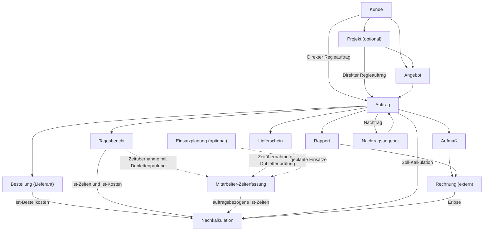

# Calight – Entwicklungsroadmap

**Stand:** 19.11.2026  

**Status:** Fachliche Zielplanung. Noch nicht implementierte Funktionen sind ausdrücklich als geplant gekennzeichnet.

Calight ist eine schlanke, selbst gehostete Anwendung für **Angebots- und Auftragsabwicklung im Handwerk und Dienstleistungsbereich**. Sie unterstützt die Kalkulation und soll künftig die Ausführung, Leistungsnachweise und Nachkalkulation begleiten. Rechnungsstellung und Buchhaltung bleiben in externen Anwendungen wie Lexware.

> Diese Roadmap ist ein Planungsdokument und keine Zusage bestimmter Veröffentlichungstermine. Der öffentlich sichtbare GitHub-Stand kann gegenüber lokalen Entwicklungsständen zurückliegen.

## Überblick

| Phase | Inhalt | Status |
|---|---|---|
| 0 | Technische Grundlagen, Anmeldung, Migrationen | Abgeschlossen laut Entwicklungsstand |
| 1 | Kunden, Projekte, Artikel- und Positionsstamm | Abgeschlossen laut Entwicklungsstand |
| 2.1–2.3 | Angebotseditor, Kalkulation, PDF und JSON | Abgeschlossen laut Entwicklungsstand |
| 2.4 | Angebotsabgabe, Validierung, Snapshot, archivierte PDF, Status | Implementiert; Integrationstests teilweise ausstehend |
| 2.5 | Angebotsrevisionen und Nachträge | Implementiert (Revisionen `0017`, Nachträge `0019`) |
| 3.1 | Auftragsverwaltung, projektfreie Angebote, direkte Regieaufträge | Implementiert (`0018`), Rollen und Bearbeitungssperren (`0020`) |
| 3.2 | Tagesberichte und interne Ist-Erfassung | Implementiert: Mitarbeiter, Tagesberichte und berichtsbezogene Ist-Zeiten (`0021`); übergreifende Zeiterfassung seit Phase 3.4.3; Berichte ohne Auftrag (`0035`) |
| 3.2.2 | Materialanforderungen, Fotos und Anhänge zu Tagesberichten | Implementiert (`0023`); PDF-Ausgabe mit Phase 3.2.3 |
| 3.2.1.x | Einheitliche Übersichts- und Detailseiten; serverseitige Pagination, Sortierung und URL-basierter Listenstatus | Implementiert (`0022`) |
| 3.2.3 | Gemeinsamer Briefbogen, PDFs für Rapporte, Aufmaße und Tagesberichte, digitale Kundenunterschrift, Rücklauf und Dokumentarchiv | Implementiert (`0027`); externe Ablage (NAS/SMB), E-Mail-Versand und Kundenportal geplant |
| 3.3 | Aufmaße für vereinbarte Angebotsleistungen | Implementiert (`0024`), PDF seit Phase 3.2.3 |
| 3.4 | Rapporte für Regieleistungen; Entwurf ohne Auftrag, Auftrag spätestens beim Einreichen | Implementiert (`0025`, `0026`), PDF und Kundenbestätigung seit Phase 3.2.3, Einsatzort / Objekt (`0028`), Auftragspflicht beim Einreichen (ohne Migration), Leistungsdatum je Stundenposition und Einreichungsdatum (`0036`) |
| 3.4.1 | Bestellungen mit PDF-Ausgabe (schlanke Materialbeschaffung) | Implementiert (`0029`); Versand per E-Mail und Bestellungen am Auftragsdetail geplant |
| 3.4.1.1 | Bestellverwaltung als Vorgang: AB, Lieferungen, Belege, Zahlungen, Lieferantenanschrift | Implementiert (`0030`); Phase 3.4.1 damit abgeschlossen |
| 3.4.2 | Zentrale Dokumentenübersicht und geschäftsbezogene Anhänge | Implementiert (`0031`) |
| 3.4.3 | Zeiterfassung: Arbeits- und Reisezeiten, Einsatz, Kilometer und Auslagen | Abgeschlossen (`0032`, Korrekturen `0033`, `0034`); zentrale Stundenbasis `0037`, Bereinigung `0038` |
| 3.4.4 | Monteurs-Interface (mobile Oberfläche für Zeiterfassung, Berichte, Rapporte) | Phase 1 implementiert (`0046`): mobiles Frontend unter `/mobile/`; Phase 2 implementiert (ohne Migration): vollständige persönliche Zeiterfassung mobil, Schutz verkaufsseitiger Werte für Monteure (`commercial.read`); mobile Berichts-, Rapport-, Material- und Aufmaßformulare folgen |
| 3.5 | Nachkalkulation und Soll-Ist-Vergleich | Geplant |
| 3.6 | Abrechnungstracking, ohne Rechnungsstellung | Geplant |
| 3.7 | Lieferscheine mit PDF-Ausgabe (Liefernachweise) | Geplant |
| 4.1 | Ansprechpartnerverwaltung | Geplant |
| 4.2 | CardDAV-Adressbücher lesend anbinden | Geplant |
| 4.3 | Kontaktübernahme und manuelle Aktualisierung | Geplant |
| 4.4 | Direktes Schreiben auf CardDAV-Server | Optional |
| 5.1–5.2 | Einsatzplanung und optionale CalDAV-Anbindung | Geplant |
| 6.1–6.2 | Erweiterte Dokumentablage und optionales Kundenportal | Geplant |
| 7.1–7.2 | Optionale Lexware-API und E-Mail-Versand | Geplant |
| UX | Projektweite Vereinheitlichung von Layout, Navigation und Aktionen | Umgesetzt (Regeln in `docs/ui-guidelines.md`); offene Einzelpunkte dort dokumentiert |

## Fachliche Grundregeln

- **Kunde:** Eigenständiger Geschäftspartner mit vollständig gespeicherten Stammdaten in SQLite.

- **Projekt:** Optionale organisatorische Klammer für mehrere Angebote und Aufträge eines Kunden. Einfache Vorgänge benötigen kein Projekt.

- **Angebot:** Kalkulierte, angebotene Leistungen. Die konkret abgegebene Fassung bleibt unveränderlich.

- **Auftrag:** Eigenständiger Vorgang zur Ausführung. Entsteht aus einem angenommenen Angebot **oder direkt ohne Angebot** als Regieauftrag.

- **Tagesbericht:** Interne Dokumentation tatsächlicher Arbeiten und Termine; kein Abrechnungsnachweis. Auftrag, Kostenstelle und Kunde sind optional; Auftrag und Kostenstelle schließen sich aus (seit `0041` „Tagesbericht“).

- **Aufmaß:** Nachweis ausgeführter Mengen zu vereinbarten Angebotspositionen.

- **Rapport:** Abrechenbarer Leistungsnachweis für Regieleistungen, typischerweise Stunden, Material und Anfahrt. Neue eingereichte Rapporte benötigen einen Auftrag.

- **Bestellung:** Beauftragung eines Lieferanten zur Materialbeschaffung; kein Wareneingangs- oder Lagerverwaltungssystem.

- **Lieferschein:** Nachweis tatsächlich an Kunden oder Baustellen gelieferter Materialien bzw. Gegenstände; keine Rechnung und kein Aufmaß.

- **Zeiterfassung:** Mitarbeiterbezogene Erfassung der gesamten Arbeitszeit, unabhängig davon, ob sie auftragsbezogen oder abrechenbar ist.
- **Einsatzplanung:** Terminliche Zuordnung von Mitarbeitern zu Aufträgen oder sonstigen Tätigkeiten; geplante Zeiten sind keine automatisch geleisteten Stunden.
- **Nachkalkulation:** Wirtschaftliche Auswertung von Soll-Leistungen, Ist-Kosten und Erlösen.

- **Abrechnung:** Rechnungen werden extern erstellt. Calight bildet nur Referenzen und Abrechnungsstände ab.

### Geplanter Geschäftsprozess

Aufmaße, Rapporte und Tagesberichte sind **unabhängig** voneinander. Bestellungen und Lieferscheine sind davon ebenfalls fachlich getrennt; sie verwenden jedoch dieselben zentralen Auftrags- und Stammdaten. Innerhalb eines Auftrags können Aufmaße und Rapporte nebeneinander vorkommen. Die Nachkalkulation kann bereits während der Ausführung erfolgen, nicht erst nach der Schlussrechnung.

## Phase 2.5 – Angebotsrevisionen und Nachträge

### Angebotsrevisionen

- Abgegebene Angebotsfassungen niemals direkt bearbeiten.

- Neue, bearbeitbare Revision mit gleicher Angebotsnummer und fortlaufender Revisionsnummer erstellen.

- Jede abgegebene Revision erhält ihren eigenen unveränderlichen Snapshot und ein archiviertes PDF.

- Vorherige Fassungen und Revisionshistorie erhalten; Revision 0 nicht eigens als „Revision 0“ anzeigen.

- Eindeutig speichern, welche Angebotsrevision tatsächlich angenommen wurde.

- Geschäftsstatus werden je abgegebener Revision geführt. Pro Angebotskette darf höchstens eine Revision gleichzeitig als angenommen markiert sein; ältere Stände und ihre Archive bleiben unverändert erhalten.

### Nachträge

- Ein Nachtrag beschreibt zusätzliche oder geänderte Leistungen **zu einem bestehenden Auftrag**; er ist nicht bloß eine neue Angebotsrevision.

- Nachträge separat kalkulieren und dem Auftrag zuordnen.

- Erst nach Annahme in den verbindlichen Leistungsumfang und die Soll-Kalkulation übernehmen.

- Originalangebot, ursprünglicher Leistungsumfang und Nachtragshistorie bleiben nachvollziehbar.

- Bestehende Kalkulations- und Angebotslogik wiederverwenden; keine zweite Kalkulationsengine schaffen.

## Phase 3.1 – Auftragsverwaltung und optionale Projekte

### Projekte werden optional

Umgesetzt: Für neue Angebote ist nur noch ein Kunde erforderlich, das Projekt ist optional.

- **Kunde ist Pflicht, Projekt ist optional** bei neuen Angeboten.

- Angebote ohne Projekt erstellen, verwalten, abgeben und bei Bedarf später einem Projekt zuordnen, ohne abgegebene Dokumente nachträglich zu verändern.

- Keine automatisch angelegten Dummy-/Standardprojekte.

- Bestehende Projekt- und Angebotszuordnungen erhalten; Validierungen, API und Datenbank auf optionalen Projektbezug anpassen.

- Projekte bleiben als eigener Menüpunkt erhalten und bündeln mehrere Angebote, Aufträge und deren Zusammenhänge; keine eigene Projekt-Kalkulationsengine.

### Zwei gleichberechtigte Wege zum Auftrag

**Angebotsauftrag**

- Entsteht aus einer angenommenen, eindeutig referenzierten Angebotsrevision.

- Nutzt den verbindlichen Angebotsumfang als Soll-Grundlage, ohne ihn als zweite unabhängige Kalkulation zu duplizieren.

- Übernimmt optionalen Projektbezug.

**Direkter Regieauftrag**

- Wird ohne Angebot und ohne Projektpflicht erstellt.

- Geeignet für Service, Wartung, Störungen und Arbeiten nach Aufwand.

- Nutzt dieselbe Auftragsverwaltung wie Angebotsaufträge.

**Gemeinsam**

- Eigene Auftragsnummer, Kunde, optionales Projekt, Beschreibung und Auftragsdatum.

- Auftragsstatus: **Offen → In Bearbeitung → Abgeschlossen → Abgerechnet**; „Abgerechnet“ nicht allein anhand einer Prozentzahl automatisch setzen.

- Ein Auftrag kann sowohl vereinbarte Angebotsleistungen als auch zusätzliche Regieleistungen und angenommene Nachträge umfassen.

- Übersicht, Suche, Filter und zentrale auftragsbezogene Detailansicht.

## Phase 3.2 – Tagesberichte und Ist-Erfassung

Tagesberichte dokumentieren die tatsächliche Ausführung und sind **keine** Aufmaße oder Rapporte.

- Je Auftrag beliebig viele Berichte mit Datum, Tätigkeiten und Bemerkungen. **(implementiert)**

- **Berichte ohne Auftrag** (Migration `0035`): z. B. Besichtigung vor dem Angebot, Bestandsaufnahme, allgemeiner Kundentermin. Kunde Pflicht, Projekt optional; kein künstlicher Auftrag. Zeiten, Materialanforderungen (mit Kundenbezug), Fotos/Anhänge und PDF (ohne Auftragszeile) funktionieren wie bisher. Übersicht mit Filtern Kunde, Projekt, „mit/ohne Auftrag“. Das Büro kann den Bericht später einem Auftrag desselben Kunden zuordnen (organisatorisch, mit Benutzer und Zeitpunkt). Seit der zentralen Stundenbasis (`0037`) folgen die Stunden dem Auftrag des Berichts; eine separate Übernahme gibt es nicht mehr. Bestehende auftragsbezogene Berichte zählen unverändert. **(implementiert)**

- Ein oder mehrere Mitarbeiter mit Arbeitszeiten und Zuordnung zu Auftrag, Titel oder Position der verbindlichen Grundlage; Kostensatz als Snapshot. **(implementiert)**

- Fotos und Anhänge je Bericht (Bilder, PDF, Text bis 15 MB), serverseitig zugriffsgeschützt. **(implementiert, Phase 3.2.2)**

- **Materialanforderungen** statt täglicher Materialverbrauchserfassung: Monteure melden benötigtes Material als Freitext mit optionaler Bemerkung und Wunschtermin aus dem Bericht oder direkt am Auftrag; das Büro bearbeitet sie zentral (offen/erledigt). Materialanforderungen sind eigenständige Datensätze mit Auftragsbezug, keine Bestellungen und keine Ist-Kosten. Eine Übernahme in Bestellungen gibt es seit Phase 3.4.1.1 bewusst nicht mehr; bestehende Verknüpfungen werden nur noch angezeigt. **(implementiert, Phase 3.2.2)**

- Artikelgenaue Ist-Materialkosten, Fahrzeiten und weitere Aufwendungen sind bewusst noch nicht umgesetzt; sie werden bei Bedarf im Zusammenhang mit der Nachkalkulation (Phase 3.5) geklärt.

- **PDF-Ausgabe** zur internen Dokumentation (Tätigkeiten, Arbeitszeiten ohne Kosten, Bemerkungen, JPEG-Fotos verkleinert eingebunden; Materialanforderungen nicht enthalten). **(implementiert, Phase 3.2.3)**

- Tatsächliche Stunden und Kosten für die Nachkalkulation bereitstellen.

- Interne Stunden **nicht** automatisch mit abrechenbaren Rapportstunden gleichsetzen.

- Eine übergreifende Zeitauswertung kann dieselben Daten nutzen; keine doppelte Zeiterfassung.

- Tagesberichte sind optional. Aufmaß oder Rapport dürfen nicht davon abhängen.

## Phase 3.2.3 – Dokumentausgabe und Kundenbestätigung

**Umgesetzt (Migration `0027`):**

- **Gemeinsame PDF-Grundlage:** projekteigene Engine `SimplePdf` (jetzt mit beliebig vielen JPEG-Bildern und optionalem Wasserzeichen) und ein gemeinsamer Briefbogen (`LetterheadPdf`) für Rapporte, Aufmaße und Tagesberichte: Logo, Firmenangaben, Kopf-/Fußbereich, Empfänger, Metadaten, Tabellen mit wiederholtem Kopf, automatische Seitenumbrüche und Seitenzahlen. Alle Firmendaten stammen aus den Dokumenteinstellungen. Der Angebots-Generator bleibt bewusst eigenständig (kein Risiko für abgabefähige Angebote); er verwendet dieselbe Engine und Einstellungen.

- **Wasserzeichen:** „ENTWURF“ nur noch auf Entwürfen. Bereits archivierte PDFs abgegebener Angebote bleiben unverändert (sie wurden mit dem früheren Verhalten erzeugt und werden nie neu erzeugt).

- **Rapport-PDF:** eingereichter Leistungsnachweis (Arbeiten, Stunden, Material, Bemerkungen, Ansprechpartner, optionaler Einsatzort / Objekt, optional Auftrag/Projekt) mit Bestätigungsbereich – nie kaufmännische Positionen, Verkaufspreise oder Kosten; auch für eigenständige Rapporte ohne Auftrag.

- **Kundenbestätigung mit getrennten Nachweisarten:**

  - **Digital unterschrieben** (`signature`): Der Monteur öffnet die Kundenansicht (ohne Navigation und Preise), der Kunde unterschreibt mit Finger, Stift oder Maus. Die Unterschrift (JPEG) wird nur angenommen, wenn die angezeigte Prüfsumme dem eingereichten Leistungsnachweis entspricht.

  - **Unterschriebenes Dokument zurückerhalten** (`returned_document`): Das Büro lädt das unterschriebene PDF oder Foto hoch; das Original wird unverändert archiviert.

  - **Manuell dokumentiert** (`manual`): nur Name und Datum ohne Nachweisdatei; ausdrücklich gekennzeichnet und kein gleichwertiger Unterschriftsnachweis.

  - **Zur Bestätigung versendet**: reiner Hinweis (Zeitpunkt, Benutzer), keine Bestätigung.

  - Jede Bestätigung ist per Datenbank-CHECK an die Prüfsumme des eingereichten Stands gebunden und einmalig; Korrekturrapporte erhalten eigene Bestätigungen.

- **Aufmaß- und Tagesbericht-PDF:** siehe Phasen 3.2 und 3.3.

- **Dokumentarchiv:** Verbindliche PDFs (Rapporte ab Einreichung, abgeschlossene Aufmaße) werden je fachlichem Stand einmal erzeugt und unter `APP_DOCUMENTS_PATH` abgelegt (`generated_documents`); spätere Abrufe liefern genau diese Datei. Ein neuer Stand (z. B. nach Kundenbestätigung) erhält eine eigene Datei, ältere bleiben erhalten.

**Geplant:** zusätzliche Ablage erzeugter Dokumente in einer konfigurierbaren Verzeichnisstruktur (z. B. eingebundenes NAS nach Kunde/Projekt/Auftrag/Dokumenttyp), E-Mail-Versand, öffentliches Bestätigungsportal, Bestellungen und Lieferscheine auf derselben Grundlage.

**Grundsätze (weiterhin gültig):**

Ziel ist, **aus einer gemeinsamen Datenbasis einheitlich gestaltete PDF-Dokumente** zu erzeugen, ohne für jede Dokumentart eine zweite Infrastruktur oder einen universellen Dokumenteneditor zu entwickeln. Die bestehende projekteigene PDF-Infrastruktur und vorhandene Angebotsvorlagen sind Ausgangspunkt; diese Phase wird bei Bedarf schrittweise mit den jeweiligen Dokumentmodulen umgesetzt.

- Zentrale, wiederverwendbare Einstellungen für Logo, Firmenanschrift, Kontaktdaten, Briefpapier, Kopf-/Fußbereich und Seitennummerierung.

- Einheitliche Grundgestaltung für Angebote, Bestellungen, Lieferscheine, Aufmaße, Rapporte und Tagesberichte; fachlich unterschiedliche Inhalte und Tabellen bleiben erlaubt.

- Kundendaten, Ansprechpartner, Lieferanten, Projekt- und Auftragsdaten aus bestehenden Stammdaten beziehungsweise verbindlichen Dokumentständen übernehmen, statt sie mehrfach zu pflegen.

- Dokumenttypbezogene PDF-Ausgabe mit sinnvoller Vorschau und nachvollziehbarer Archivierung.

- Verbindlich ausgestellte beziehungsweise abgeschlossene Dokumente als unveränderliche Fassungen aufbewahren; Korrekturen über nachvollziehbare neue Stände statt stilles Überschreiben.

- Bestehende Angebots-Snapshots und archivierte PDFs dürfen durch eine Vorlagenvereinheitlichung **niemals nachträglich verändert oder neu erzeugt** werden.

- Keine allgemeine WYSIWYG-Dokumentenverwaltung, kein separates DMS und keine zweite PDF-Engine ohne konkreten Bedarf.

- Technische Details und genaue Ausbaustufen anhand der vorhandenen Implementierung entscheiden; vorhandene Architektur bevorzugt erweitern.

## Phase 3.3 – Aufmaße

Aufmaße dokumentieren die **abrechenbaren ausgeführten Mengen vereinbarter Leistungen**.

**Umgesetzt (Phase 3.3, Migration `0024`):**

- Positionen aus der verbindlichen Auftragsgrundlage und angenommenen Nachträgen werden stabil über interne IDs referenziert (`order|addendum : Quell-ID : Knoten-ID`); offene oder abgelehnte Nachträge erscheinen nicht.

- Mehrere Aufmaße je Auftrag. Mengen eines Aufmaßes sind **Zusatzmengen**; der Fortschritt (vereinbart, bisher, dieses Aufmaß, gesamt, offen) ergibt sich aus der Summe abgeschlossener Aufmaße. Nur Positionen mit Menge werden gespeichert.

- Bewertung ausschließlich zu den verbindlichen Einzelpreisen (`effectiveUnitPrice`) ohne Neukalkulation; Zeilenbetrag = Menge × Einzelpreis, kaufmännisch auf Cent. Bedarfs- und Alternativpositionen (auch geerbt über Bedarfs-/Alternativtitel) sind gekennzeichnet und werden mit ihrem Preis bewertet. Der Angebotsnachlass bzw. -aufschlag des jeweiligen Quelldokuments wird – wie in der Kalkulation – nur auf Normalpositionen und im Verhältnis zur vereinbarten Normalsumme angewendet. Ein vollständig aufgemessener Auftrag entspricht damit (bis auf Cent-Rundungen je Aufmaß) der Auftragssumme.

- Entwürfe sind bearbeitbar (Versionsprüfung) und löschbar; der Abschluss vergibt die Aufmaßnummer (Nummernkreis „Aufmaße“, `AM`), schreibt Summen je Quelldokument fest und macht das Aufmaß unveränderlich. Positionstexte, Einheiten, vereinbarte Mengen und Preise werden je Zeile als Snapshot gespeichert.

- Mengenüberschreitungen werden angezeigt und erfordern beim Abschluss eine ausdrückliche Bestätigung (je Zeile protokolliert); zusätzliche Leistungen bleiben Sache eines Nachtrags.

- Prüfung gegen bereits abgeschlossene Mengen und Abschluss laufen in einer Schreibtransaktion, sodass gleichzeitig abgeschlossene Aufmaße desselben Auftrags berücksichtigt werden.

- Korrekturen abgeschlossener Aufmaße erfolgen über ein **Korrekturaufmaß** (Verweis auf das korrigierte Aufmaß, auch negative Mengen; die Gesamtmenge darf nicht unter null fallen). Ein Storno- oder Rechnungswesen ist bewusst nicht enthalten.

- Rechte: `measurements.read`/`measurements.write` (Büro, Monteur – Monteure nur freigegebene Aufträge und eigene Entwürfe), `measurements.complete` für Abschluss und Korrektur (Büro/Admin).

**PDF (Phase 3.2.3):** Abgeschlossene Aufmaße und Korrekturaufmaße als PDF mit Titelhierarchie, vereinbarter, bisheriger, aktueller und kumulierter Menge, Mehrmengen und den festgeschriebenen Summen; einmal erzeugt und archiviert. Entwürfe nur als Vorschau mit Wasserzeichen.

- Als Anlage bzw. Grundlage für Abschlags- und Schlussrechnungen verwendbar.

- Keine Gleichsetzung aufgemessener Mengen mit tatsächlichem Materialverbrauch.

## Phase 3.4 – Rapporte

Rapporte dokumentieren **abrechenbare Regieleistungen** und entsprechen in ihrer Abrechnungsfunktion dem Aufmaß. Ein Rapport ist ein **eigenständiger Leistungsnachweis**: Für den Entwurf ist nur der Kunde Pflicht. **Ein Rapport darf ohne Auftrag begonnen werden. Spätestens bei der Einreichung muss ein Auftrag zugeordnet oder automatisch angelegt werden.** Historische, vor dieser Regel eingereichte Rapporte ohne Auftrag bleiben gültig und können vom Büro nachträglich zugeordnet werden. Es gibt keine Zuordnung zu Angebotspositionen.

**Umgesetzt (Phase 3.4, Migration `0025`):**

- **Zwei getrennte Ebenen:** Der Monteur erfasst den **Leistungsnachweis** (Leistungsdatum/-zeitraum, Ansprechpartner vor Ort, optionaler Einsatzort / Objekt als Freitext – z. B. „Werk 2, Produktionshalle 4“, unabhängig von Kunde, Projekt und Auftrag, Migration `0028` –, ausgeführte Arbeiten, Bemerkungen, Stunden je Mitarbeiter mit optionaler Lohnkostengruppe, Material und sonstige Leistungen als Freitext mit Menge) – ohne Preise. Das Büro erstellt daraus die **kaufmännischen Abrechnungspositionen** (Arbeitsstunden, Material, Anfahrt/Fahrtkosten, Fremdleistung, Pauschale, sonstige Leistung) mit Menge, Einheit und Verkaufspreis; Artikel und Lohnkostengruppen können mit ihrem Verkaufspreis aus dem Stamm übernommen werden (Snapshot, keine spätere Aktualisierung).

- **Status:** Entwurf → Eingereicht → Bearbeitet. Beim Einreichen erhält der Rapport seine Nummer (Nummernkreis „Rapporte“, `RP`), der Leistungsnachweis wird gesperrt und per SHA-256 festgeschrieben. „Bearbeitet“ schreibt den Nettobetrag fest und kann vom Büro wieder geöffnet werden; der Leistungsnachweis bleibt davon unberührt.

- **Eigenständige Rapporte (Migration `0026`):** Monteure legen vor Ort für einen bestehenden Kunden einen Rapport an, ohne dass vorher ein Auftrag existieren muss; beim Anlegen wird kein Auftrag erzeugt. Wird ein Auftrag gewählt, muss er zum Kunden gehören.
- **Leistungsdatum je Stundenposition (Migration `0036`):** Jede Stundenposition hat ein eigenes Datum (vorbelegt mit dem Datum der vorherigen Position bzw. heute); mehrere Mitarbeiter je Tag, ein Mitarbeiter an mehreren Tagen und mehrere Positionen je Mitarbeiter und Tag sind möglich, weiterhin ohne Uhrzeiten. Die allgemeinen Felder „Leistungsdatum“ und „Bis“ entfallen. Der Rapportkopf zeigt das Einreichungsdatum (Serverzeit beim Einreichen), Entwürfe „Rapport · Entwurf“. PDF und Unterschriftsseite zeigen die Positionen mit Datum, nach Datum geordnet. Die Zeiterfassung zeigt Rapportstunden am jeweiligen Positionsdatum (nur Referenz). Historische eingereichte Rapporte bleiben unverändert (Prüfsumme, PDF, Bestätigung, Leistungsdatum im Kopf); bestehende Entwürfe übernehmen ihr bisheriges Leistungsdatum je Position.
- **Auftragspflicht beim Einreichen:** Hat der Entwurf keinen Auftrag, fragt der Dialog „Auftrag für Rapport festlegen“: bestehenden Auftrag des Rapportkunden wählen (Suche über Nummer und Bezeichnung; nur offene oder laufende Aufträge, für Monteure nur freigegebene) oder einen neuen Regieauftrag anlegen lassen. Der Regieauftrag entsteht über die vorhandene Regieauftragslogik (reguläre Nummer, Status „offen“, Kunde, Bezeichnung „Regiearbeiten – Einsatzort“ bzw. „– Leistungsdatum“, Auftragsdatum = Leistungsdatum, ohne Angebot oder Positionen). Monteure dürfen das nur für ihren eigenen Entwurf; ein allgemeines Recht zur Auftragsanlage entsteht nicht. Zuordnung, Auftragsanlage und Einreichung sind eine Transaktion mit Versionsprüfung; wiederholte oder parallele Anfragen erzeugen keinen zweiten Auftrag. Der Auftrag ist Teil der Prüfsumme und wird vor ihr gesetzt; PDFs werden erst beim Abruf archiviert. Korrekturen übernehmen den Auftrag des Originals (auch einen nachträglich zugeordneten). Das Büro kann einen eigenständigen Rapport nachträglich einem Auftrag desselben Kunden zuordnen (einmalig, mit Benutzer und Zeitpunkt); Leistungsnachweis, Prüfsumme, Kundenbestätigung und Abrechnungspositionen bleiben dabei unverändert. Die Übersicht filtert nach Kunde und „mit/ohne Auftrag“.

- **Korrekturen:** neuer Korrekturrapport mit Verweis auf das Original und dessen Stand als Ausgangspunkt; das Original und eine vorhandene Kundenbestätigung bleiben unverändert.

- **Kundenbestätigung (vorbereitet):** unabhängig vom Bearbeitungsstatus, einmalig mit Name, Zeitpunkt und Art (vor Ort/nachträglich); sie ist datenbankseitig an die Prüfsumme des eingereichten Leistungsnachweises gebunden und wird nie auf einen geänderten Stand übertragen. Rapporte ohne Bestätigung sind zulässig.

- **Rechte:** `workreports.read`/`workreports.write` (Büro, Monteur – Monteure sehen eigene Rapporte immer, fremde nur an freigegebenen Aufträgen und fremde eigenständige Rapporte nie; sie bearbeiten nur eigene Entwürfe, Bestätigungen und Korrekturen), `workreports.process` (Büro/Admin) für Abrechnungspositionen, Stammübernahme, Abschluss, Wiederöffnen und nachträgliche Auftragszuordnung. Preise und Beträge liefert auch die API nur mit diesem Recht aus.

- Rapportstunden mit Mitarbeiter sind tatsächliche Arbeitszeit und zählen genau einmal in der zentralen Stundenbasis (`time_entries`); Rapportarbeiten gehören nicht zusätzlich in einen Tagesbericht. Rapportbeträge (Verkaufspreise) verändern keine Ist-Kosten.

**PDF und Kundenbestätigung (Phase 3.2.3):** Rapport-PDF des eingereichten Leistungsnachweises ohne Preise, mit Unterschriftsbereich; digitale Unterschrift vor Ort, Rücklauf unterschriebener Dokumente und manuelle Dokumentation als getrennte Nachweisarten (siehe Phase 3.2.3).

**Offen:** E-Mail-Versand und ein öffentliches Bestätigungsportal; optionale Übernahme aus Tagesberichten.

## Phase 3.4.1 / 3.4.1.1 – Bestellungen und Beschaffung (abgeschlossen, Migrationen `0029`, `0030`)

**Grundsatz:** schlanke, vorgangsorientierte Beschaffung – keine Warenwirtschaft, kein Lager, keine Buchhaltung. Übersicht unter „Kaufmännisch → Bestellungen“.

**Erfassen:**
- **Neue Bestellung:** Lieferant wählen oder direkt im Dialog anlegen (nur Name Pflicht), optional Auftrag; Positionen manuell oder aus dem Artikelstamm; Bestell-PDF; ausgegebene Fassungen unveränderlich archiviert.
- **Externe Bestellung aufnehmen:** Lieferant (auch neu), Datum, externe Referenz, optional Betrag und Datei; keine Positionen, kein eigenes PDF.
- Die Übernahme aus Materialanforderungen wurde gestrichen; Bestandsverknüpfungen aus `0029` werden nur angezeigt.

**Lieferantenstamm:** optional Straße, Hausnummer, PLZ, Ort, Land und die eigene Kundennummer beim Lieferanten. Anschrift und Kundennummer stehen im Snapshot und auf dem Bestell-PDF. Ältere JSON-Importe ohne diese Felder leeren sie nicht.

**Vorgänge (beliebige Reihenfolge, unveränderlich, je mit optionalem Beleg):**
- **Auftragsbestätigungen:** Nummer, Datum, bestätigter Netto­betrag und Liefertermin, Bemerkung. Mehrere Fassungen; genau eine ist ausdrücklich „aktuell“.
- **Lieferungen:** Teillieferung, vollständige Lieferung (ohne Mengenabgleich), Rücksendung, Lieferkorrektur. Der Lieferstatus ist der Status nach dem zuletzt erfassten Ereignis; bei Rücksendung und Korrektur wird er gewählt. Lieferungen ändern nie Kosten.
- **Lieferantenbelege:** Rechnung, Teilrechnung, Schlussrechnung, Gutschrift, Stornobeleg. Beträge positiv erfasst; Kostenwirkung berechnet ausschließlich `Domain\Purchase\PurchaseCostCalculator`: Rechnungen erhöhen, Gutschriften senken, Stornobelege mindern ihren Originalbeleg. Schlussrechnung entweder „zusätzlicher Betrag“ oder „Gesamtrechnung einschließlich Teilrechnungen“ (dann werden die wirksamen Teilrechnungen abgezogen; danach keine weiteren Teilrechnungen). Belege werden nie gelöscht; Kosten dürfen nicht negativ werden.
- **Zahlungen:** Zahlung (optional „vollständig bezahlt“), Rückerstattung, Statuskorrektur. Zahlungen ändern keine Kosten; offener Bruttobetrag nur, wenn alle Belege einen Bruttobetrag haben.

**Beträge strikt getrennt:** ursprünglicher Bestellwert (`expected_net_total`), aktuell bestätigter Wert (aktuelle AB), tatsächliche Nettokosten.

**Ist-Kosten:** direkt erfasster Betrag **oder** Belege, nie beides. Der erste Beleg ersetzt einen direkten Betrag nur nach ausdrücklicher Bestätigung (protokolliert).

**Kostenverteilung:** Standard ist der Auftrag der Bestellung; optional feste Beträge. Gespeicherte Verteilungen dürfen die Ist-Kosten nie übersteigen. Sinken die Ist-Kosten später (Gutschrift, Storno, geänderter direkter Betrag), wird der Beleg trotzdem erfasst; die Verteilung wird nicht still gekürzt, sondern als ungültig markiert (Hinweis mit „Verteilung korrigieren …“, Verlaufseintrag, `allocationExceeded` in Detail und `costsByOrder`). `costsByOrder` bezieht stornierte Bestellungen mit ein.

**Stornieren:** über „Weitere Aktionen“ mit optionalem Grund; Lieferungen, Belege, Zahlungen, Dokumente und Ist-Kosten bleiben, Gutschriften und Rücksendungen sind weiter möglich, neue Fassungen nicht.

**Oberfläche:** kompakter Kopf mit drei Status, drei Beträgen (einzige Betragsübersicht) und Lieferanten-/Kundennummer; Bereiche Bestellung (Bearbeiten über eigene Aktion), Auftragsbestätigungen, Lieferungen, Rechnungen und Gutschriften, Zahlungen, Dokumente und Verlauf (einklappbar); jede Erfassung in einem kleinen Dialog (`purchase-order-dialogs.js`). Die Übersicht hat kein Aktionsmenü je Zeile; Vorgänge werden auf der Detailseite erfasst. Status in der Liste: „Entwurf“, „Storniert“ oder „Bestellt · Lieferung · Zahlung“. Lieferanten-Schnellanlage über den Plus-Knopf neben der Suche (eigener Dialog über dem Bestelldialog).

**Bestandsdaten (`0030`):** bisherige Rechnungen gelten als normale Rechnungen; manuell gesetzte Liefer-/Zahlungsstatus werden als Korrekturereignis übernommen.

**Bewusst offen:** E-Mail-Versand an den Lieferanten, Bestellungen auf der Auftragsdetailseite, Positionsvorschläge aus der Auftragsgrundlage, Wareneingang je Position, Mahnwesen/Bankanbindung. Abgrenzung: Lieferscheine (Phase 3.4.2) betreffen die Übergabe von Material an Kunden/Baustellen, nicht die Beschaffung.

Ursprüngliche Planung:

Bestellungen sind **an Lieferanten gerichtete Beschaffungsdokumente**, keine Rechnungen und keine Lager- oder Wareneingangsbuchungen. Ziel ist die einfache Erstellung einer einheitlichen Bestellung als PDF aus Calight.

- Bestellung zu einem Auftrag erstellen; bei Bedarf auch projekt- und auftragsunabhängige Beschaffung ermöglichen.

- Lieferant aus vorhandenen Stammdaten wählen; Liefer- und Bestellanschrift sowie Ansprechpartner bei Bedarf ergänzen.

- Materialbedarf aus der verbindlichen Auftragsgrundlage einschließlich angenommener Nachträge als Vorschlag übernehmen oder Positionen frei erfassen; Übernahme bleibt bewusst editierbar.

- Positionen mit Bezeichnung, Menge, Einheit und gegebenenfalls Einkaufspreis für den Bestellbeleg speichern, damit der ursprüngliche Beleg später reproduzierbar bleibt.

- Eigene Bestellnummer, Datum, optional Liefertermin, Referenz und knapper Bearbeitungsstatus; konkrete Statusfolge vor Implementierung festlegen.

- Einheitliches Bestell-PDF über die zentrale Dokumentvorlage erzeugen und ausgestellte Fassungen unveränderlich archivieren.

- Für die Nachkalkulation **tatsächliche Gesamtkosten je Bestellung** erfassen; Einzelartikel müssen nicht als eigener Wareneingangs- oder Verbrauchsprozess nachverfolgt werden.

- Keine Lagerbestände, Reservierungen, Wareneingangspositionen, automatische Lieferantenkommunikation oder vollständige Warenwirtschaft als Voraussetzung.

- Bestehende Materialbedarfslisten erhalten und bei Bedarf als Ausgangspunkt nutzen; keine doppelte Material- oder Preislogik schaffen.

## Phase 3.4.2 – Zentrale Dokumentenübersicht und geschäftsbezogene Anhänge (implementiert, Migration `0031`)

**Grundsatz:** Calight ist **kein Dokumentenmanagementsystem** und kein allgemeiner Datei- oder Projektdateimanager. Es gibt keine Ordner, Tags, Volltextsuche, Versionierung, Freigabe-Workflows, öffentliche Links oder DMS-Anbindung.

**Architektur:**
- Vorhandene Fachdokumente bleiben unverändert in ihren Modulen und Ablagen (Angebots-PDFs, Bestell-PDFs und Lieferantenbelege, Rapport-PDFs und Bestätigungsnachweise, Aufmaß-PDFs, Tagesbericht-PDFs und -Anhänge). Die Übersicht ist eine **Leseprojektion** (`DocumentService`, `DocumentRepository`) und verlinkt auf die bestehenden, rechtegeprüften Download-Routen. Keine Kopien, keine Verschiebung, keine zweite Archivierung.
- Neu sind nur **allgemeine Anhänge** (`attachments`) mit Zuordnungen (`attachment_links`) zu Kunde, Ansprechpartner, Projekt, Angebot und Auftrag. Eine Datei wird einmal gespeichert (`APP_DOCUMENTS_PATH/attachments/JJJJ/MM/<uuid>.<ext>`), Typ am Inhalt geprüft (PDF, Bilder), höchstens 15 MB.
- Kontext: Dokumente erscheinen direkt beim zugeordneten Objekt und indirekt bei dessen Kunde/Projekt/Auftrag (z. B. Rapport-PDF beim Auftrag), je Liste nur einmal.

**Oberfläche:**
- „Allgemein → Dokumente“: reine Lese- und Downloadübersicht (Suche, Dokumentart, Kunde, Projekt, Auftrag – auch indirekt –, Zeitraum, Dateityp, Sortierung, Seiten, Tabelle/Karten). Kein Hochladen, Bearbeiten oder Löschen.
- Bereich „Dokumente“ bei Kunde, Projekt, Angebot und Auftrag: zugehörige Dokumente, „Dokument hochladen“ (Datei, optional Titel/Beschreibung; beim Kunden optional zusätzlich ein Ansprechpartner) und Entfernen eigener Anhänge.

**Rechte:**
- Übersicht und Dokumentbereiche setzen `documents.read` voraus (Büro/Admin). Techniker sehen ihre Dokumente weiterhin nur in den Fachmodulen.
- Fachdokumente: Rechte des Fachmoduls (z. B. `offers.read`, `workreports.read`); Lieferantenrechnungen und ausgegebene Bestell-PDFs (mit Preisen) zusätzlich `costs.read`.
- Allgemeine Anhänge: sichtbar nur, wenn der Benutzer **jedes** zugeordnete Objekt lesen darf (keine Rechteausweitung durch Mehrfachzuordnung). Hochladen/Zuordnen erfordert Schreibrecht auf jedes Ziel; Entfernen einer Zuordnung Schreibrecht auf dieses Objekt. Mit der letzten Zuordnung wird der Anhang samt Datei gelöscht; Fachdokumente sind über diesen Weg nie löschbar.
- Zuordnungen auf nicht mehr vorhandene Objekte werden ignoriert.

**Bewusst offen:** serverseitige SQL-Pagination der Projektion (derzeit Zusammenführung im Server, ausreichend für überschaubare Mengen); Upload-Ereignisse im fachlichen Verlauf der Objekte. Lieferscheine (Phase 3.4.3) werden als weitere Quelle der Projektion ergänzt.

## Zentrale Stundenbasis (Migration `0037`, Abschluss vor Phase 3.4.4)

**Grundsätze:** Rapporte und Tagesberichte sind eigenständige Quellen tatsächlicher Mitarbeiterstunden. Die Zeiterfassung führt alle Stunden zusammen und ergänzt allgemeine Tätigkeiten sowie Uhrzeiten. Ein Korrekturrapport ersetzt seinen Vorgänger vollständig; ausschließlich die jeweils gültige Fassung ist maßgeblich. Die Stundenmenge eines Berichts kann nicht durch die Zeiterfassung verändert werden. Die Nachkalkulation verwendet nur die zentrale Ist-Stundenbasis.

- **Eine Basis:** `time_entries` mit Herkunft Rapport, Tagesbericht oder manuell; je Berichtsstundenposition genau eine Buchung (eindeutige Referenz, Löschung per Kaskade). Gleiche Mitarbeiter, Tage oder Aufträge werden nie automatisch zusammengeführt.
- **Rapport:** Stunden erscheinen sofort am Leistungsdatum (Entwurf als „Entwurf“ gekennzeichnet); das Einreichen erzeugt keine zweite Buchung. Korrekturentwürfe wirken nicht; beim Einreichen ersetzt die Korrektur atomar die Buchungen der Vorgängerfassung. Ergänzte Uhrzeiten werden nur bei eindeutig gleicher Position (Mitarbeiter, Datum, Dauer) übernommen. Ersetzte Fassungen bleiben vollständig erhalten.
- **Tagesbericht:** Stunden erscheinen automatisch; Stundenkorrekturen am Bericht wirken sofort (ohne Differenzbuchung, mit Benutzer). Die Auftragszuordnung kann vom Büro gesetzt, geändert oder entfernt werden – die Stunden folgen (protokolliert). Die frühere separate „Stundenübernahme“ entfällt.
- **Zeiterfassung:** Tag/Woche/Monat zeigen alle Herkünfte mit Kennzeichnung und Link zum Bericht. Für Berichtsbuchungen werden nur Beginn, Ende, Pause, Reisezeit und Einsatzart ergänzt; Ende − Beginn − Pause muss exakt der Berichtsdauer entsprechen (sonst eigener Zeitblock oder Berichtskorrektur). Manuelle Zeitblöcke wie bisher, ohne Uhrzeiten nur mit Dauer, wenn die Betriebseinstellung es erlaubt. Überschneidungsprüfung über alle Buchungen mit Uhrzeiten.
- **Einstellungen → Betrieb** (nur Administratoren): „Stundenerfassung ohne Uhrzeiten erlauben“ (Standard: an). Aus: Stunden ohne Uhrzeiten zählen voll, sind aber „Uhrzeiten fehlen“; Auswertungen weisen sie gesondert aus.
- **Bereinigung (Migration `0038`):** Die für die Überführung eingeführte Altfallverwaltung und die frühere Quellenwahl (`time_source_choices`) wurden entfernt. **Rapporte, Tagesberichte und manuelle Zeiterfassung erzeugen gemeinsam genau eine zentrale Ist-Stundenbasis**; es gibt keine konkurrierenden Stundenquellen. Vorhandene Testbuchungen bleiben erhalten und zählen regulär.

## Phase 3.4.3 – Zeiterfassung (abgeschlossen, Migrationen `0032`, `0033`, `0034`; seit `0037` zentrale Stundenbasis)

**Grundsatz:** tatsächliche Arbeits- und Reisezeiten je Mitarbeiter und Tag – keine Lohn-, Reisekosten- oder Personalverwaltung, keine Stempeluhr, kein GPS, keine automatischen Pauschalen oder steuerlichen Einstufungen.

- **Zeitblöcke:** Datum, Beginn, Ende (Ende ≤ Beginn = Folgetag), Pause, Reisezeitanteil, Einsatzart, Auftrag/Kostenstelle und Bemerkung; ohne Uhrzeiten nur die Dauer (Betriebseinstellung). Tätigkeitsarten gibt es seit Migration `0044` nicht mehr; der Erfassungsdialog bietet „Arbeitszeit“ oder „Abwesenheit“.
- **Begriffe und Rechnung überall gleich:** Nettozeit = Ende − Beginn − Pause; Reisezeit ist Teil der Nettozeit (≤ Nettozeit, ein reiner Fahrtblock hat Reisezeit = Nettozeit); übrige Arbeitszeit = Nettozeit − Reisezeit. Reisezeit gehört zum Auftrag des Blocks.
- **Über Mitternacht:** Die Bruttozeit wird nach Uhrzeit auf die Kalendertage verteilt; Pause und Reisezeit (ohne eigene Uhrzeit erfasst) im Verhältnis der Bruttozeit, auf Minuten gerundet. Tag, Woche, Monat, Büroauswertung und Ist-Stunden je Auftrag verwenden dieselben Kalendertag-Anteile (`split`); die Tagesansicht zeigt die Fortsetzung vom Vortag, die Auswertung zeigt bei Blöcken an der Zeitraumgrenze Anteil und Gesamtblock. Die Auftragssumme ohne Zeitraum ist unabhängig von der Aufteilung.
- **Reisekosten und Auslagen (Dialog je Tag, seit Migration `0043`):** 1. Auswärtstätigkeit und Verpflegung (Kategorie, Einsatzort, Inland/Ausland, optionale Abwesenheitsdauer, Übernachtung, gestellte Mahlzeiten, Bemerkung) mit rechnerischer Verpflegungspauschale; 2. mehrere dienstliche Privat-Pkw-Fahrten (Kilometer, Strecke, Zweck, optional Auftrag/Kostenstelle) mit rechnerischem Kilometerbetrag; 3. Auslagen mit Betrag, Zweck, Auftrag/Kostenstelle und Beleg. Pauschalen, Kürzungen, Abwesenheitsgrenze und Kilometersatz sind globale Betriebseinstellungen. Referenzwerte, keine steuerliche Freigabe, Auszahlung oder Lohnbuchung; Auslandspauschalen, Dreimonatsfrist, erste Tätigkeitsstätte und Eigenzahlungen prüft das Büro.
- **Ansichten:** Woche (Start) und Monat als Kalenderraster mit sieben Spalten Mo–So (auch auf Smartphones), ISO-Kalenderwoche, heutiger Tag hervorgehoben, Klick öffnet den Tag; Monat mit Summen für Nettozeit, Reisezeit, übrige Arbeitszeit, Kilometer und Auslagen. Für das Büro Mitarbeiterauswahl und Auswertung nach Zeitraum, Mitarbeiter und Auftrag.
- **Ist-Stunden (`TimeTrackingService::actualHoursForOrder`):** seit `0037` ausschließlich aus der zentralen Stundenbasis (siehe oben); die frühere Quellenwahl ist mit `0038` entfernt. Auslagen und Kilometer werden nicht bewertet.
- **Schnittstelle für Phase 3.5:** `actualHoursForOrder(orderId, actor, from?, to?)` liefert Kalendertag-Anteile (`items` mit Mitarbeiter, Kalendertag, Beginntag, Herkunft und Bericht, Netto-, Reise- und übriger Arbeitszeit, Kennzeichen „Uhrzeiten fehlen“, Kostensatz-Snapshot nur mit `costs.read`), Summen je Mitarbeiter und Herkunft sowie Gesamtsummen.
- **Kostensatz:** Snapshot beim Anlegen, nur mit `costs.read` sichtbar; Bewertung in Phase 3.5.
- **Rechte:** `timesheet.own` (eigener Mitarbeiterdatensatz, aktive Mitarbeiter, Techniker nur freigegebene Aufträge), `timesheet.manage` (alle Mitarbeiter, Korrekturen, Auswertung).
- **Bestandsdaten (`0033`):** bisherige Blöcke „Fahrt“ behalten ihre Tätigkeit und erhalten die gesamte Nettozeit als Reisezeit (keine Doppelzählung); eine bisherige Einsatzart je Tag wurde auf die Blöcke des Tages ohne eigene Angabe übertragen und bleibt als historischer Wert gespeichert.

**Bewusst offen:** Freigabe-Workflow, Export, Ruhezeit über mehrere Tage, Gültigkeitshistorie der Kostensätze (nur Snapshot je Eintrag), Bewertung der Ist-Stunden (Phase 3.5).

## Allgemeine Kostenstellen (Migration `0039`, implementiert)

Neben Kundenaufträgen gibt es frei verwaltbare interne Kostenstellen (Stammdaten → Kostenstellen, z. B. K100 Verwaltung & Büro). Überall, wo Arbeitszeiten oder Kosten zugeordnet werden, gibt es **ein** Suchfeld „Auftrag / Kostenstelle“ für Auftrags- und Kostenstellennummern und -bezeichnungen – ohne Typauswahl. Calight bleibt ausdrücklich keine Buchhaltungssoftware.

- **Zeiterfassung:** Manuelle Zeitblöcke und Auslagen auf Auftrag oder Kostenstelle. Rapportstunden folgen ausschließlich dem Auftrag ihres Rapports.
- **Tagesberichte (Migration `0040`):** Kostenziel über dasselbe Feld – Kundenauftrag, allgemeine Kostenstelle (z. B. Angebotsbesichtigung beim Kunden auf K110) oder keines; der Kunde ist seit `0041` optional. Die Zeitbuchungen übernehmen das Ziel; das Büro kann es nachträglich in alle Richtungen wechseln (protokolliert, keine neuen Buchungen). PDF zeigt die Kostenstelle statt einer Auftragsnummer. Rapporte bleiben ausschließlich auftragsbezogen. Gesamtstunden bleiben unverändert; Auftrags-Ist-Stunden enthalten keine Kostenstellenstunden. Die Auswertung gruppiert nach Auftrag / Kostenstelle.
- **Tagesberichte (Migration `0041`):** sichtbare Umbenennung „Bautagesbericht“ → „Tagesbericht“ (technische Namen unverändert). Kunde optional (`daily_reports.customer_id` und `material_requests.customer_id` nullable, Neuaufbau von sieben Tabellen mit Datenerhalt); Materialanforderungen übernehmen die Kostenstelle des Berichts (`material_requests.cost_center_id`). Anlegen: Auftrag/Kostenstelle → Berichtsdatum → Bezeichnung → Kunde → Projekt. Rapporte unverändert auftragsbezogen.
- **Einreichung und Festschreibung (Migration `0042`):** Mitarbeiter reichen Woche oder Monat ein (Betriebseinstellung „Einreichungsrhythmus“), das Büro prüft unter „Zeiterfassung → Freigaben“, bestätigt Hinweise, schreibt fest, gibt mit Begründung zurück oder öffnet einzelne Tage wieder. Sperre je Mitarbeiter und Tag, zentral per Trigger für alle Module (manuell, Tagesberichte, Rapporte inkl. Korrekturen, Tagesangaben, Auslagen). Global einstellbare Prüfgrenzwerte (Standard nach ArbZG). Archivierte, revisionierte PDF-Stundennachweise je Woche/Monat mit festem Datenstand; keine Kostensätze. Feiertage nur bundesweit.
- **Abwesenheiten und Kalenderhinweise (Migration `0044`):** Abwesenheiten (Urlaub, Feiertag, Krankheit, Zeitausgleich, Arbeitsfrei, Sonstige; ganztägig oder stundenweise) getrennt von der Ist-Arbeitszeit, in Kalender, Auswertung und Nachweisen; Erfassungsdialog „Arbeitszeit / Abwesenheit“ ohne Tätigkeitsarten; Sperrfehler (rot ✕) und Warnungen (orange ⚠) direkt am Kalendertag; Einreichung ab dem letzten Tag des Zeitraums mit Vollständigkeitsbestätigung. Bewusst nicht: Urlaubsanspruch, Anträge, Sollzeiten, Zeitkonten, automatische Feiertage.
- **Tagesberichte abschließen (Migration `0045`):** Status Entwurf, eingereicht, festgeschrieben, zur Korrektur geöffnet, storniert mit Protokoll; archivierte PDF-Revisionen; Einzel- und Sammelfestschreibung mit der Arbeitszeitfreigabe; offene Tagesberichte blockieren die Zeiterfassungseinreichung; Storno entfernt die Zeitbuchungen (nur auf offenen Tagen). Oberfläche: Status und Aktionen im Kopfbereich, kompaktes Datumsfeld, vereinfachte Zuordnung, Stundenzeilen ohne Positionszuordnung, Statusfilter. Dokumentenübersicht mit festgeschriebenen Wochen-/Monatsstundennachweisen und archivierten Tagesbericht-PDFs (aktuell/ersetzt, nur referenziert, rechtegeprüft).
- **Bestellungen:** Hauptzuordnung auf Auftrag oder Kostenstelle; gemischte Bestellungen über die vorhandene Kostenverteilung (feste Nettobeträge je Auftrag oder Kostenstelle). Eine positionsweise Zuordnung sieht die Bestellarchitektur nicht vor und wurde bewusst nicht eingeführt.
- **Übersicht je Kostenstelle und Kalenderjahr:** Arbeitszeit (zentrale Zeitbuchungen nach Buchungstag); mit `costs.read` Bestellkosten (Bestelldatum, nur bekannte Ist-Kosten, bei Verteilung nur der zugeordnete Betrag) und Auslagen. Keine Umlagen, Zuschläge, Hierarchien oder Verteilungsschlüssel.
- **Vorlage:** Zehn typische Kostenstellen (K100–K190) optional übernehmbar, idempotent.

## Phase 3.4.4 – Monteurs-Interface

Mobile, auf das Wesentliche reduzierte Oberfläche für Monteure: Zeiterfassung als Einstieg, dazu Tagesberichte, Rapporte, Aufmaße und Materialanforderungen der freigegebenen Aufträge. Nutzt die vorhandenen Fachmodule und Rechte; keine eigene Datenhaltung.

### Phase 1 – mobile Grundarchitektur (implementiert, Migration `0046`)

- **Eigenständiges Frontend** unter `/mobile/` in derselben Anwendung: eigenes Layout (`templates/layout/mobile.php`, `assets/mobile.css`, `assets/mobile.js`), kompakter Kopf mit Benutzermenü, feste Navigation unten (Start · Aufträge · Zeiten · Mehr), Karten und Listen statt Tabellen. Dieselbe Session, API, Fachlogik, Datenbank, Benutzerverwaltung und Modulkonfiguration; keine zweite Instanz.
- **Routen:** `/mobile/` (Startseite), `/mobile/orders` (Suche, Filter Aktiv/Abgeschlossen/Abgerechnet/Alle, serverseitige Seiten), `/mobile/orders/{id}` (Auftragsdetail), `/mobile/times` (Tageszeiten, nur lesend), `/mobile/more`, `/mobile/manifest.webmanifest`, `/mobile/sw.js`, `POST /interface` (Oberflächenwechsel).
- **Einstieg:** Monteure landen nach der Anmeldung mobil, Büro und Administratoren in der Büroansicht. Büro/Administratoren wechseln über das Benutzermenü (Recht `interface.switch`); die Auswahl wird als `users.preferred_interface` gespeichert. Keine Weiterleitung nach Bildschirmgröße. Optional `APP_MOBILE_HOST`: Auf diesem Hostnamen führt der Einstieg immer zum mobilen Frontend (gleiche Routen, keine Cross-Origin-Aufrufe).
- **Rechte:** Die mobile Oberfläche ist keine Sicherheitsgrenze. `AuthorizationPolicy` ordnet die Routen den bestehenden Rechten zu (`dashboard.read`, `orders.read`, `timesheet.own`); Datensatzrechte (z. B. Monteure nur freigegebene Aufträge) prüfen die Fachdienste. Projektionen aus `MobileWorkspace` enthalten keine Preise, Summen, Kostensätze oder Kalkulationsdaten – für alle Rollen.
- **Startseite:** Arbeitszeit des Tages, Prüfhinweise der Woche aus `TimeApprovalService::check`, offene eigene Vorgänge (Tagesberichte, Rapport- und Aufmaßentwürfe, Materialbedarf), Schnellzugriffe und aktuelle Aufträge – nur tatsächliche Daten, nur aktive Module und Schreibrechte.
- **Auftragsdetail:** Kopf, Kunde/Projekt, Einsatzort (Baustellenadresse des Projekts, Kartenlink), Ansprechpartner mit `tel:`/`mailto:`-Links, beauftragte Leistungen (Nummer, Kurztext, Menge, Einheit; aus `OrderBasisPositions` ohne Preise), Unterlagen (`documents.read`), Tagesberichte, Rapporte, Materialbedarf und Aufmaße. Erfassungseinstiege übernehmen den Auftrag über die vorhandenen Einstiege (`create_for` bzw. Auftragsreiter).
- **PWA-Grundlagen:** Manifest (Name, Icons, `standalone`, Start und Scope `/mobile/`), Service Worker nur als Hinweisseite bei fehlender Verbindung; er speichert keine Seiten, API-Antworten, Dokumente oder Zugangsdaten. Mobile Seiten werden mit `Cache-Control: no-store` ausgeliefert. Service Worker benötigt HTTPS (oder localhost).
### Phase 2 – mobile Zeiterfassung (implementiert, ohne Migration)

- `/mobile/times` ist die vollständige persönliche Zeiterfassung: Ansichten Tag (Buchungen, Abwesenheiten, Reisekosten, Tageshinweise), Woche (sieben Tage als Liste mit Stunden, Status, Sperrfehlern/Warnungen) und Monat (kompakter Kalender), Datumsnavigation und „Zu heute“. Maßgeblich ist ausschließlich der über `employees.user_id` zugeordnete Mitarbeiter; keine Mitarbeiterauswahl und keine Zuordnung über Namen. Ohne Zuordnung erscheint ein Hinweis, persönliche Erfassungsaktionen sind ausgeblendet (`TimeTrackingService::ownEmployee`). Büro und Administratoren erfassen eigene Zeiten wie Monteure, sobald ihnen ein Mitarbeiter zugeordnet ist.
- Mobile Formulare (Vollbild-Blatt, Speichern unten erreichbar, Rückfrage bei ungespeicherten Änderungen, nach dem Speichern zurück zur Tagesansicht) für manuelle Zeitblöcke (Beginn/Ende/Pause/Reisezeit oder – laut Betriebseinstellung – nur Dauer, Auftrag/Kostenstelle, Einsatzart, Bemerkung), Uhrzeiten zu Rapport- und Tagesberichtstunden (Dauer unveränderlich), Abwesenheiten (alle Arten, ganztägig oder stundenweise), Auswärtstätigkeit und gestellte Mahlzeiten, mehrere Privat-Pkw-Fahrten, Auslagen mit Beleg per Kamera oder Datei. Aus einem Auftrag geöffnet, ist dessen Zuordnung vorbelegt (`/mobile/times?form=entry&order=<id>`).
- Einreichung von Woche bzw. Monat mit Vollständigkeitsbestätigung, Sperrfehler und Warnungen, Freigabestatus, Rückgabegründe und eigene archivierte Stundennachweise; eingereichte und festgeschriebene Tage nur lesend. Keine Bürofreigaben und keine fremden Zeiten.
- Umsetzung ausschließlich als Client der bestehenden API `/api/time-tracking/*` (`assets/mobile-times.js`); Berechnung, Validierung, Sperren und Pauschalen bleiben serverseitig.
- **Kaufmännischer Schutz:** neues Recht `commercial.read` (Büro, Administratoren). Ohne dieses Recht entfernt `ConfidentialDataFilter::salesValues` Einzelpreise, Auftrags- und Nachtragssummen, Aufmaßbeträge und die vollständige Auftragsgrundlage aus `/api/orders`, der Auftragsdetailseite und allen Aufmaß-Antworten; Sortierung nach Summe ist dann nicht möglich, das Aufmaß-PDF (Kundendokument mit Preisen) nur mit `commercial.read`. Leistungsbeschreibungen, Mengen, Einsatzorte und Kontaktdaten bleiben sichtbar.

- **Bewusst noch nicht:** mobile Formulare für Tagesberichte, Rapporte mit Unterschrift, Material und Aufmaß (vorübergehend öffnen diese Einstiege die bestehenden responsiven Seiten), Offline-Erfassung/IndexedDB/Synchronisation, Push, native Apps, Mitarbeiterzuordnung zu Aufträgen und Einsatzplanung.

## Phase 3.5 – Nachkalkulation

- **Soll bei Angebotsaufträgen:** Angenommene Angebotsrevision sowie angenommene Nachträge.

- **Ist:** Lohnstunden aus `TimeTrackingService::actualHoursForOrder` – ausschließlich die zentrale Stundenbasis (Rapport, Tagesbericht, manuell; jede Buchung genau einmal, keine Prioritätsregeln), bewertet mit den gespeicherten Kostensatz-Snapshots; Material, Fremdleistung und sonstige Kosten aus Bestellungen. Auslagen und Privat-Pkw-Beträge der Zeiterfassung nur nach ausdrücklicher Entscheidung einbeziehen; Abwesenheiten nie.

- Tatsächliche Bestellgesamtkosten können in die Ist-Kosten einfließen; Doppelzählung gegenüber bereits erfasstem Materialverbrauch vermeiden.

- **Erlösseite:** Abrechenbare beziehungsweise tatsächlich abgerechnete Leistungen getrennt erfassen.

- Stunden, Kosten, Abweichungen, Deckungsbeiträge und Auftragsergebnis auswerten.

- Auch direkte Regieaufträge ohne ursprüngliche Soll-Kalkulation wirtschaftlich auswerten.

- Auswertung fortlaufend während der Auftragsbearbeitung ermöglichen.

## Phase 3.6 – Abrechnungstracking

Calight ersetzt **keine** Faktura oder Buchhaltung.

- Referenzen auf extern erstellte Rechnungen hinterlegen: Rechnungsnummer, Datum, Netto-Betrag, Auftrag und optional Aufmaß/Rapport.

- Abschlags- und Schlussrechnungen getrennt nachvollziehen; Doppelzählung vermeiden.

- Abrechnungsstand und offene Leistungen anzeigen.

- Auftragsstatus „Abgerechnet“ ausdrücklich bestätigen lassen.

- Keine eigene Rechnungsstellung, Zahlungsbuchhaltung oder Debitorenverwaltung.

## Phase 3.7 – Lieferscheine und Liefernachweise (geplant)

Lieferscheine dokumentieren **an Kunden oder Baustellen tatsächlich übergebene Materialien beziehungsweise Gegenstände**. Sie sind unabhängig von Bestellungen, Tagesberichten, Aufmaßen und Rapporten.

- Lieferschein in der Regel zu einem Auftrag erstellen; ein unabhängiger Lieferschein kann bei echtem Bedarf später ergänzt werden.

- Empfänger, Lieferadresse, Datum und optionalen Ansprechpartner aus vorhandenen Daten vorbelegen; Änderungen im Dokument zulassen, ohne Stammdaten rückwirkend zu verändern.

- Gelieferte Positionen mit Bezeichnung, Menge, Einheit und optional Bemerkung erfassen; bei Bedarf aus vorhandenen Auftragspositionen oder Artikeln übernehmen.

- Eigener Lieferscheinnummernkreis und einheitliches PDF ohne standardmäßige Preisangaben.

- Optionale Empfangsbestätigung beziehungsweise Unterschrift; keine Pflicht zu einer komplexen digitalen Signaturfunktion.

- Ausgestellte Lieferscheine und zugehörige Empfängerdaten als unveränderliche Dokumentstände archivieren.

- Kein automatischer Materialverbrauch, keine Lagerbuchung und keine Gleichsetzung gelieferter Mengen mit aufgemessenen oder abrechenbaren Mengen.

## Phase 4 – Ansprechpartner und CardDAV

### 4.1 Ansprechpartner

- Mehrere Ansprechpartner je Kunde mit Name, Funktion, E-Mail und Telefon.

- Als eigene kundenzugeordnete Datensätze in SQLite, auch vollständig ohne CardDAV.

- In Projekten, Angeboten und Aufträgen auswählbar.

- Diese Struktur bei früheren Anpassungen der Kundenverwaltung nach Möglichkeit mit berücksichtigen.

### 4.2 CardDAV lesend

- Menüpunkt **Kontakte** als Ansicht externer CardDAV-Adressbücher.

- Beliebig viele konfigurierte Adressbücher/Server, beispielsweise Radicale.

- Personen und Organisationen suchen und anzeigen.

- Optionaler lokaler Lesecache; **keine zusätzliche allgemeine lokale Kontaktverwaltung**.

- Sichere Speicherung der Zugangsdaten, Fehlerbehandlung bei Nichterreichbarkeit.

### 4.3 Manuelle Kontaktübernahme

- Kunden und Ansprechpartner können jederzeit vollständig ohne CardDAV-Verknüpfung bestehen.

- Bei Bedarf Daten aus CardDAV-Kontakten in eigenständige SQLite-Datensätze kopieren.

- Optionale Quellenreferenz (Adressbuch, Ressourcenadresse, Kontakt-UID) speichern.

- Button **„Aus Kontakt aktualisieren“**: neue Daten abrufen, Änderungen feldweise anzeigen und erst nach manueller Bestätigung übernehmen.

- Keine automatische Kundendaten-Synchronisation, keine Rückübertragung von Kundenänderungen an CardDAV.

- Beim Löschen/Verschieben eines CardDAV-Kontakts bleiben Kunden, Ansprechpartner und Dokumente bestehen.

### 4.4 Optional: CardDAV schreibend

- Kontakt direkt auf dem CardDAV-Server erstellen, bearbeiten oder löschen.

- Keine Offline-Schreibwarteschlange und kein Konflikt-Merge.

- ETag-Prüfung mit `If-Match` für Änderungen/Löschen und `If-None-Match: *` für Neuanlagen; bei konkurrierender Änderung neu laden.

- Schreibzugriff ist nicht Voraussetzung für Phase 4.2 und 4.3.

## Phase 5 – Einsatzplanung und CalDAV (geplant)

### 5.1 Einfache interne Einsatzplanung

- Kalenderansichten für Tag, Woche und Monat; Termine und Einsätze mit Beginn, Ende, Beschreibung und optionalem Einsatzort.
- Zuordnung zu einem oder mehreren Mitarbeitern sowie optional zu Kunde, Projekt oder Auftrag; auch interne Termine ohne Auftrag ermöglichen.
- Einfache Übersicht, wer wann für welchen Einsatz vorgesehen ist; übersichtliche Darstellung von Überschneidungen.
- Verknüpfung mit der Mitarbeiter-Zeiterfassung nur als Planungshilfe: geplante Stunden werden niemals automatisch als geleistet oder abrechenbar gebucht.
- Rollen und Zugriffsrechte beachten. Keine Gantt-Planung, automatische Tourenoptimierung oder komplexe Ressourcenverwaltung.

### 5.2 Optionale CalDAV-Anbindung

- Externe Kalender über CalDAV anbinden, beispielsweise selbst gehostete Kalenderdienste.
- Zunächst eine klar begrenzte Richtung der Übertragung festlegen, vorzugsweise Calight-Einsätze in externe Kalender bereitstellen; Synchronisationsumfang vor Implementierung definieren.
- Optional später bidirektionale Synchronisation mit eindeutigen Ereignis-IDs, Konfliktbehandlung und Schutz vor doppelten Terminen.
- Zugangsdaten geschützt speichern; Fehler und Nichterreichbarkeit dürfen die interne Einsatzplanung nicht blockieren.
- Calight bleibt ohne CalDAV vollständig nutzbar; keine Cloudpflicht.

## Phase 6 – Erweiterte Dokumentablage und Kundenportal (geplant)

Die bestehende gemeinsame PDF-Ausgabe und Archivierung aus Phase 3.2.3 bleibt Grundlage. **Keine neue PDF-Engine und kein eigenständiges DMS** einführen.

### 6.1 Konfigurierbare externe Dokumentablage

- Optional zusätzliche strukturierte Ablage auf einem eingebundenen NAS-/SMB-Verzeichnis, etwa nach Kunde, Projekt, Auftrag und Dokumentart.
- Pfade, Dateinamen und Zugriffsschutz zentral konfigurieren; vorhandenes `APP_DOCUMENTS_PATH` und unveränderliche archivierte Dokumentstände respektieren.
- Fehler der externen Ablage nachvollziehbar behandeln; keine stillschweigende Löschung oder Veränderung bestehender Dateien.

### 6.2 Optionales Kundenportal zur Bestätigung

- Zeitlich begrenzter, geschützter Zugriff auf gezielt freigegebene Leistungsnachweise und deren Bestätigung.
- Bestehende Prüfsummen-, Unterschrifts- und Archivierungslogik wiederverwenden; keine allgemeine Kundenplattform voraussetzen.
- Berechtigungen, Datenschutz, Widerruf von Freigaben und Protokollierung vor Umsetzung festlegen.

## Phase 7 – Optionale externe Integrationen (geplant)

### 7.1 Lexware-API

- Optionaler Austausch abrechnungsrelevanter Auftrags-, Kunden-, Aufmaß- und Rapportdaten mit Lexware, soweit die tatsächlich verfügbare API dies unterstützt.
- Externe Rechnungsnummern, Beträge und Status nach Möglichkeit dem Abrechnungstracking (Phase 3.6) zuordnen; keine doppelte Rechnungserstellung oder unkontrollierte Synchronisation.
- Authentifizierung, API-Grenzen und verfügbare Funktionen erst vor Implementierung prüfen. Calight bleibt ohne Lexware-Anbindung voll nutzbar und ersetzt keine Buchhaltung.

### 7.2 E-Mail-Versand

- Angebote, Rapporte und weitere freigegebene Dokumente optional direkt per SMTP versenden.
- Konfigurierbare, sicher gespeicherte SMTP-Zugangsdaten; Empfänger vor Versand prüfen und Versandstatus dokumentieren.
- Bestehende archivierte PDF-Fassungen versenden, nicht unbemerkt neu erzeugen. Kein eigener Mailserver und keine umfangreiche E-Mail-Verwaltung.

## Projektweite UX- und Navigationsvereinheitlichung (umgesetzt)

Umgesetzt: einheitliche Aktionen, Menüs, Statusfarben, Formulare und Suchkomponenten (`Calight.suggest`, `Calight.searchableSelect`) sowie die Sidebar nach Arbeitsbereichen. Verbindliche Regeln und verbleibende Einzelpunkte stehen in [`ui-guidelines.md`](ui-guidelines.md).

- Einheitliche Positionierung, Benennung, Reihenfolge und Darstellung von primären, sekundären und destruktiven Aktionen.
- Gleiche Such- und Auswahlkomponenten für Kunden, Projekte, Artikel, Mitarbeiter, Lieferanten und andere Stammdaten, soweit fachlich sinnvoll.
- Kontextabhängige Aktionen in vorhandene Dropdown-/Kontextmenüs bündeln; wichtige Hauptaktionen direkt sichtbar halten.
- Lokale Lucide-Icons konsistent einsetzen, keine dekorative Icon-Flut. Dialoge, Statusanzeigen, Filter, Tabellen, Karten und mobile Ansichten vereinheitlichen.
- Navigation nach Arbeitsabläufen statt nach jeder einzelnen Datenbankentität gliedern; Berechtigungen und bestehende URLs erhalten. Keine umfassende Neugestaltung auf Kosten der Bedienbarkeit.

## Dokumente und Datenintegrität

- Kundendaten bleiben in SQLite eigenständig, auch wenn Kontaktverknüpfungen geändert oder gelöscht werden.

- Bei Erstellung eines Dokuments werden relevante Kunden- und Ansprechpartnerdaten übernommen.

- Angebotsentwürfe behalten diese Werte bis zu einer ausdrücklich ausgelösten Aktualisierung.

- Abgegebene Angebote, archivierte PDFs und verbindliche ausgestellte Aufmaße/Rapporte bleiben mit ihren ursprünglichen Empfänger- und Leistungsdaten unverändert.

- Dasselbe gilt künftig für ausgestellte Bestellungen und Lieferscheine: Empfänger, Positionen und PDF-Stand bleiben historisch nachvollziehbar.

- Einheitliches Briefpapier und gemeinsame PDF-Vorlagen werden zentral gepflegt; Vorlagenänderungen wirken nur auf neue Ausgaben, niemals rückwirkend auf archivierte Dokumente.

- Bereits abgegebene Dokumente nicht rückwirkend durch Stammdaten-Updates ändern.

- Bestehende Angebots-JSONs, SQLite-Dateien und Archivdateien dürfen durch Migrationen, Tests oder Git-Operationen nicht beschädigt oder versehentlich eingecheckt werden.

## Modularisierung (implementiert, ohne Migration)

Funktionsbereiche lassen sich global unter **Einstellungen → Module** schalten (nur Administratoren, `operations.manage`). Zentrale Registrierung: `Application\ModuleService` (Definitionen, Routenpräfixe, offene Vorgänge); Persistenz in `operational_settings` (`modules.<schlüssel>`), ohne Eintrag aktiv – bestehende Installationen behalten den vollen Umfang.

| Modul | Schlüssel | Stand |
|---|---|---|
| Basissystem | `core` | immer aktiv |
| Arbeitserfassung | `work_tracking` | implementiert, schaltbar |
| Beschaffung | `procurement` | implementiert, schaltbar (inkl. Materialbedarf) |
| Abrechnung, Nachkalkulation, Kontakte, Kalender, Lexware | `billing`, `job_costing`, `contacts`, `calendar`, `lexware` | vorgesehen, noch nicht aktivierbar |

- Deaktiviert: lesende Aufrufe und Direktlinks bleiben möglich (Hinweis im Seitenkopf), schreibende Aufrufe der Modulrouten lehnt `Application::handle` mit 409 ab – zusätzlich zur Berechtigung. Keine Daten werden gelöscht; Einstellungen bleiben gespeichert und sind nach Reaktivierung wieder sichtbar.
- Deaktivierung ist nach ausdrücklicher Bestätigung auch bei offenen Vorgängen möglich; der Dialog führt Entwürfe, offene Berichte, Freigaben, nicht eingereichte Arbeitszeiten, Bestellungen und Materialanforderungen auf. Nichts wird geändert, abgeschlossen oder storniert; nach Wiederaktivierung geht es regulär weiter. Dynamisch aufgebaute Seiten deaktivierter Module blenden alle Bearbeitungs-, Lösch- und Statusaktionen aus.
- Kostenstellen sind sichtbar und pflegbar, solange Arbeitserfassung oder Beschaffung aktiv ist. Lieferanten und Mitarbeiter bleiben gemeinsame Stammdaten des Basissystems.
- Ohne Beschaffung keine neuen Materialanforderungen (auch nicht aus Tagesberichten, Prüfung zusätzlich in `MaterialRequestService`).

## Navigation

Aktuell umgesetzt (nur implementierte, aktive und berechtigte Einträge; leere Gruppen entfallen):
- **Allgemein:** Übersicht · Kunden · Projekte · Dokumente
- **Auftragsabwicklung:** Angebote · Aufträge · Aufmaße
- **Arbeitserfassung:** Zeiterfassung · Tagesberichte · Rapporte
- **Beschaffung:** Bestellungen (Reiter „Bestellungen | Materialbedarf“; ohne Bestellrecht direkt „Materialbedarf“)
- **Verwaltung:** Stammdaten · Einstellungen

Kontakte und Kalender (Allgemein) sowie **Kaufmännisch** (Abrechnung, Nachkalkulation) erscheinen erst mit ihrer Implementierung. Lexware und weitere Integrationen gehören später unter Einstellungen.

Die Auftragsdetailseite ist in Reiter gegliedert: Übersicht (Summen, Kennzahlen, Statusverlauf), Leistungen (Auftragsgrundlage, Nachträge), Ausführung (Tagesberichte, Rapporte), Material (Materialbedarf, Bestellungen), Aufmaße, Dokumente. Reiter abgeschalteter Module erscheinen nur bei vorhandenen Daten und ohne Anlegeaktionen. Stunden kommen in Übersicht und Ausführung aus derselben Aggregation der zentralen Basis (`DailyReportService::orderHours`): gesamt, festgeschrieben, vorläufig sowie davon aus Rapporten, Tagesberichten und manuell; Bestell-Ist-Kosten nur mit `costs.read`, Bestellungen ohne bekannte Ist-Kosten werden gesondert genannt und nicht als 0 gewertet.

## Technische Leitlinien

- Bestehender Stack: **PHP, Apache, SQLite, HTML/CSS/Vanilla JavaScript, JSON und die projekteigene PDF-Infrastruktur**.

- Self-Hosting ohne Cloudzwang; Docker als derzeit primärer Betriebsweg.

- Vorhandene Kalkulationslogik, Datenmodelle und PDF-Infrastruktur wiederverwenden.

- Gemeinsame PDF-Vorlagen und zentrale Dokumentdaten bevorzugen; fachlich getrennte Dokumenttypen statt eines universellen Dokumenteneditors.

- Fachliche Ziele verbindlich halten, konkrete technische Umsetzung nach Prüfung des aktuellen Codes eigenständig und möglichst einfach wählen.

- Änderungen klein, testbar und migrationssicher halten; keine unnötigen Frameworks oder Microservices.

- SQLite mit passenden Indizes und kurzen Transaktionen nutzen; Dateispeicherung und Archivierung beibehalten.

- Berechtigungen, CSRF, ETag/Konkurrenzschutz, Datenschutz und konsistente Backups berücksichtigen.

- Öffentliche README dokumentiert die groben Phasen; diese Datei dient als fachliche Detailreferenz.

## Vor einer Implementierung noch festzulegen

1\. Nummerierung, Status und Freigabe von Nachträgen.

2\. Preisgrundlagen und Verrechnungssätze für Regiearbeiten.

3\. Mengenänderungen und Freigabe von Teilaufmaßen.

4\. Korrektur, Unterschrift und Archivierung von Rapporten.

5\. Ist-Kostenerfassung ohne Tagesbericht.

6\. Behandlung von Abschlags-/Schlussrechnungen ohne Doppelzählung.

7\. Datenmigration für optionale Projekte und Ansprechpartner.

8\. CardDAV-Feldzuordnung und Umgang mit verschobenen Kontakten.

Diese Fragen jeweils vor der betroffenen Phase klären, nicht alles vorab implementieren.

---

**Entwicklungsprozess:** Die Roadmap beschreibt das Zielbild. Umsetzung erfolgt in gesondert beauftragten Phasen; lokale Git-Commits ohne automatisches Pushen.
