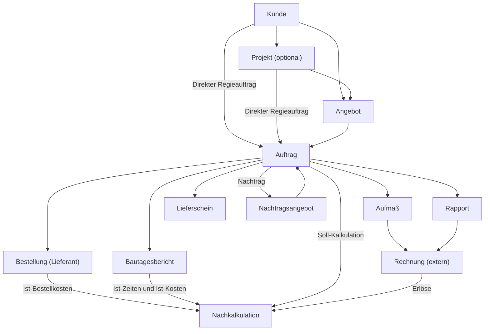

# Calight – Entwicklungsroadmap

**Stand:** 12.11.2026  

**Status:** Fachliche Zielplanung. Noch nicht implementierte Funktionen sind ausdrücklich als geplant gekennzeichnet.

Calight ist eine schlanke, selbst gehostete Anwendung für **Angebots- und Auftragsabwicklung im Handwerk und Dienstleistungsbereich**. Sie unterstützt die Kalkulation und soll künftig die Ausführung, Leistungsnachweise und Nachkalkulation begleiten. Rechnungsstellung und Buchhaltung bleiben in externen Anwendungen wie Lexware.

> Diese Roadmap ist ein Planungsdokument und keine Zusage bestimmter Veröffentlichungstermine. Der öffentlich sichtbare GitHub-Stand kann gegenüber lokalen Entwicklungsständen zurückliegen.

## Überblick

| Phase | Inhalt | Status |

|---|---|---|

| 0 | Technische Grundlagen, Anmeldung, Migrationen | Abgeschlossen laut Entwicklungsstand |

| 1 | Kunden, Projekte, Artikel- und Positionsstamm | Abgeschlossen laut Entwicklungsstand |

| 2.1–2.3 | Angebotseditor, Kalkulation, PDF und JSON | Abgeschlossen laut Entwicklungsstand |

| 2.4 | Angebotsabgabe, Validierung, Snapshot, archivierte PDF, Status | Implementiert; Integrationstests teilweise ausstehend |

| 2.5 | Angebotsrevisionen und Nachträge | Implementiert (Revisionen `0017`, Nachträge `0019`) |

| 3.1 | Auftragsverwaltung, projektfreie Angebote, direkte Regieaufträge | Implementiert (`0018`), Rollen und Bearbeitungssperren (`0020`) |

| 3.2 | Bautagesberichte und interne Ist-Erfassung | Implementiert: Mitarbeiter, Berichte und Zeiterfassung (`0021`) |

| 3.2.2 | Materialanforderungen, Fotos und Anhänge zu Bautagesberichten | Implementiert (`0023`); PDF-Ausgabe in Phase 3.2.3 verschoben |

| 3.2.1.x | Einheitliche Übersichts- und Detailseiten; serverseitige Pagination, Sortierung und URL-basierter Listenstatus | Implementiert (`0022`) |
| 3.2.3 | Gemeinsame Dokumentvorlagen und PDF-Grundlagen (schrittweise) | Geplant; bestehende Angebots-PDF-Infrastruktur vorhanden |

| 3.3 | Aufmaße für vereinbarte Angebotsleistungen | Implementiert (`0024`); PDF-Ausgabe in Phase 3.2.3 |

| 3.4 | Rapporte für Regieleistungen, auch eigenständig ohne Auftrag | Implementiert (`0025`, `0026`); PDF, Unterschrift und Übermittlung in Phase 3.2.3 |

| 3.4.1 | Bestellungen mit PDF-Ausgabe (schlanke Materialbeschaffung) | Geplant |
| 3.4.2 | Lieferscheine mit PDF-Ausgabe (Liefernachweise) | Geplant |
| 3.5 | Nachkalkulation und Soll-Ist-Vergleich | Geplant |

| 3.6 | Abrechnungstracking, ohne Rechnungsstellung | Geplant |

| 4.1 | Ansprechpartnerverwaltung | Geplant |

| 4.2 | CardDAV-Adressbücher lesend anbinden | Geplant |

| 4.3 | Kontaktübernahme und manuelle Aktualisierung | Geplant |

| 4.4 | Direktes Schreiben auf CardDAV-Server | Optional |

## Fachliche Grundregeln

- **Kunde:** Eigenständiger Geschäftspartner mit vollständig gespeicherten Stammdaten in SQLite.

- **Projekt:** Optionale organisatorische Klammer für mehrere Angebote und Aufträge eines Kunden. Einfache Vorgänge benötigen kein Projekt.

- **Angebot:** Kalkulierte, angebotene Leistungen. Die konkret abgegebene Fassung bleibt unveränderlich.

- **Auftrag:** Eigenständiger Vorgang zur Ausführung. Entsteht aus einem angenommenen Angebot **oder direkt ohne Angebot** als Regieauftrag.

- **Bautagesbericht:** Tagesdokumentation tatsächlicher Tätigkeiten, Zeiten und Aufwendungen; kein Abrechnungsnachweis.

- **Aufmaß:** Nachweis ausgeführter Mengen zu vereinbarten Angebotspositionen.

- **Rapport:** Nachweis abrechenbarer Regieleistungen, typischerweise Stunden, Material und Anfahrt.

- **Bestellung:** Beauftragung eines Lieferanten zur Materialbeschaffung; kein Wareneingangs- oder Lagerverwaltungssystem.
- **Lieferschein:** Nachweis tatsächlich an Kunden oder Baustellen gelieferter Materialien bzw. Gegenstände; keine Rechnung und kein Aufmaß.
- **Nachkalkulation:** Wirtschaftliche Auswertung von Soll-Leistungen, Ist-Kosten und Erlösen.

- **Abrechnung:** Rechnungen werden extern erstellt. Calight bildet nur Referenzen und Abrechnungsstände ab.

### Geplanter Geschäftsprozess

Aufmaße, Rapporte und Bautagesberichte sind **unabhängig** voneinander. Bestellungen und Lieferscheine sind davon ebenfalls fachlich getrennt; sie verwenden jedoch dieselben zentralen Auftrags- und Stammdaten. Innerhalb eines Auftrags können Aufmaße und Rapporte nebeneinander vorkommen. Die Nachkalkulation kann bereits während der Ausführung erfolgen, nicht erst nach der Schlussrechnung.

## Phase 2.5 – Angebotsrevisionen und Nachträge

### Angebotsrevisionen

- Abgegebene Angebotsfassungen niemals direkt bearbeiten.

- Neue, bearbeitbare Revision mit gleicher Angebotsnummer und fortlaufender Revisionsnummer erstellen.

- Jede abgegebene Revision erhält ihren eigenen unveränderlichen Snapshot und ein archiviertes PDF.

- Vorherige Fassungen und Revisionshistorie erhalten; Revision 0 nicht eigens als „Revision 0“ anzeigen.

- Eindeutig speichern, welche Angebotsrevision tatsächlich angenommen wurde.

- Geschäftsstatus werden je abgegebener Revision geführt. Pro Angebotskette darf höchstens eine Revision gleichzeitig als angenommen markiert sein; ältere Stände und ihre Archive bleiben unverändert erhalten.

### Nachträge

- Ein Nachtrag beschreibt zusätzliche oder geänderte Leistungen **zu einem bestehenden Auftrag**; er ist nicht bloß eine neue Angebotsrevision.

- Nachträge separat kalkulieren und dem Auftrag zuordnen.

- Erst nach Annahme in den verbindlichen Leistungsumfang und die Soll-Kalkulation übernehmen.

- Originalangebot, ursprünglicher Leistungsumfang und Nachtragshistorie bleiben nachvollziehbar.

- Bestehende Kalkulations- und Angebotslogik wiederverwenden; keine zweite Kalkulationsengine schaffen.

## Phase 3.1 – Auftragsverwaltung und optionale Projekte

### Projekte werden optional

Umgesetzt: Für neue Angebote ist nur noch ein Kunde erforderlich, das Projekt ist optional.

- **Kunde ist Pflicht, Projekt ist optional** bei neuen Angeboten.

- Angebote ohne Projekt erstellen, verwalten, abgeben und bei Bedarf später einem Projekt zuordnen, ohne abgegebene Dokumente nachträglich zu verändern.

- Keine automatisch angelegten Dummy-/Standardprojekte.

- Bestehende Projekt- und Angebotszuordnungen erhalten; Validierungen, API und Datenbank auf optionalen Projektbezug anpassen.

- Projekte bleiben als eigener Menüpunkt erhalten und bündeln mehrere Angebote, Aufträge und deren Zusammenhänge; keine eigene Projekt-Kalkulationsengine.

### Zwei gleichberechtigte Wege zum Auftrag

**Angebotsauftrag**

- Entsteht aus einer angenommenen, eindeutig referenzierten Angebotsrevision.

- Nutzt den verbindlichen Angebotsumfang als Soll-Grundlage, ohne ihn als zweite unabhängige Kalkulation zu duplizieren.

- Übernimmt optionalen Projektbezug.

**Direkter Regieauftrag**

- Wird ohne Angebot und ohne Projektpflicht erstellt.

- Geeignet für Service, Wartung, Störungen und Arbeiten nach Aufwand.

- Nutzt dieselbe Auftragsverwaltung wie Angebotsaufträge.

**Gemeinsam**

- Eigene Auftragsnummer, Kunde, optionales Projekt, Beschreibung und Auftragsdatum.

- Auftragsstatus: **Offen → In Bearbeitung → Abgeschlossen → Abgerechnet**; „Abgerechnet“ nicht allein anhand einer Prozentzahl automatisch setzen.

- Ein Auftrag kann sowohl vereinbarte Angebotsleistungen als auch zusätzliche Regieleistungen und angenommene Nachträge umfassen.

- Übersicht, Suche, Filter und zentrale auftragsbezogene Detailansicht.

## Phase 3.2 – Bautagesberichte und Ist-Erfassung

Bautagesberichte dokumentieren die tatsächliche Ausführung und sind **keine** Aufmaße oder Rapporte.

- Je Auftrag beliebig viele Berichte mit Datum, Tätigkeiten und Bemerkungen. *(implementiert)*

- Ein oder mehrere Mitarbeiter mit Arbeitszeiten und Zuordnung zu Auftrag, Titel oder Position der verbindlichen Grundlage; Kostensatz als Snapshot. *(implementiert)*

- Fotos und Anhänge je Bericht (Bilder, PDF, Text bis 15 MB), serverseitig zugriffsgeschützt. *(implementiert, Phase 3.2.2)*

- **Materialanforderungen** statt täglicher Materialverbrauchserfassung: Monteure melden benötigtes Material als Freitext mit optionaler Bemerkung und Wunschtermin aus dem Bericht oder direkt am Auftrag; das Büro bearbeitet sie zentral (offen/erledigt). Materialanforderungen sind eigenständige Datensätze mit Auftragsbezug, keine Bestellungen und keine Ist-Kosten. Eine spätere Bestellfunktion (Phase 3.4.1) kann sie übernehmen. *(implementiert, Phase 3.2.2)*

- Artikelgenaue Ist-Materialkosten, Fahrzeiten und weitere Aufwendungen sind bewusst noch nicht umgesetzt; sie werden bei Bedarf im Zusammenhang mit der Nachkalkulation (Phase 3.5) geklärt.

- Die **PDF-Ausgabe von Bautagesberichten** gehört zur gemeinsamen Dokumentphase 3.2.3 und wird dort mit der einheitlichen Vorlage umgesetzt.

- Tatsächliche Stunden und Kosten für die Nachkalkulation bereitstellen.

- Interne Stunden **nicht** automatisch mit abrechenbaren Rapportstunden gleichsetzen.

- Eine übergreifende Zeitauswertung kann dieselben Daten nutzen; keine doppelte Zeiterfassung.

- Bautagesberichte sind optional. Aufmaß oder Rapport dürfen nicht davon abhängen.

## Phase 3.2.3 – Einheitliche Dokumentvorlagen und PDF-Grundlagen (geplant)

Ziel ist, **aus einer gemeinsamen Datenbasis einheitlich gestaltete PDF-Dokumente** zu erzeugen, ohne für jede Dokumentart eine zweite Infrastruktur oder einen universellen Dokumenteneditor zu entwickeln. Die bestehende projekteigene PDF-Infrastruktur und vorhandene Angebotsvorlagen sind Ausgangspunkt; diese Phase wird bei Bedarf schrittweise mit den jeweiligen Dokumentmodulen umgesetzt.

- Zentrale, wiederverwendbare Einstellungen für Logo, Firmenanschrift, Kontaktdaten, Briefpapier, Kopf-/Fußbereich und Seitennummerierung.
- Einheitliche Grundgestaltung für Angebote, Bestellungen, Lieferscheine, Aufmaße, Rapporte und Bautagesberichte; fachlich unterschiedliche Inhalte und Tabellen bleiben erlaubt.
- Kundendaten, Ansprechpartner, Lieferanten, Projekt- und Auftragsdaten aus bestehenden Stammdaten beziehungsweise verbindlichen Dokumentständen übernehmen, statt sie mehrfach zu pflegen.
- Dokumenttypbezogene PDF-Ausgabe mit sinnvoller Vorschau und nachvollziehbarer Archivierung.
- Verbindlich ausgestellte beziehungsweise abgeschlossene Dokumente als unveränderliche Fassungen aufbewahren; Korrekturen über nachvollziehbare neue Stände statt stilles Überschreiben.
- Bestehende Angebots-Snapshots und archivierte PDFs dürfen durch eine Vorlagenvereinheitlichung **niemals nachträglich verändert oder neu erzeugt** werden.
- Keine allgemeine WYSIWYG-Dokumentenverwaltung, kein separates DMS und keine zweite PDF-Engine ohne konkreten Bedarf.
- Technische Details und genaue Ausbaustufen anhand der vorhandenen Implementierung entscheiden; vorhandene Architektur bevorzugt erweitern.

## Phase 3.3 – Aufmaße

Aufmaße dokumentieren die **abrechenbaren ausgeführten Mengen vereinbarter Leistungen**.

**Umgesetzt (Phase 3.3, Migration `0024`):**

- Positionen aus der verbindlichen Auftragsgrundlage und angenommenen Nachträgen werden stabil über interne IDs referenziert (`order|addendum : Quell-ID : Knoten-ID`); offene oder abgelehnte Nachträge erscheinen nicht.
- Mehrere Aufmaße je Auftrag. Mengen eines Aufmaßes sind **Zusatzmengen**; der Fortschritt (vereinbart, bisher, dieses Aufmaß, gesamt, offen) ergibt sich aus der Summe abgeschlossener Aufmaße. Nur Positionen mit Menge werden gespeichert.
- Bewertung ausschließlich zu den verbindlichen Einzelpreisen (`effectiveUnitPrice`) ohne Neukalkulation; Zeilenbetrag = Menge × Einzelpreis, kaufmännisch auf Cent. Bedarfs- und Alternativpositionen (auch geerbt über Bedarfs-/Alternativtitel) sind gekennzeichnet und werden mit ihrem Preis bewertet. Der Angebotsnachlass bzw. -aufschlag des jeweiligen Quelldokuments wird – wie in der Kalkulation – nur auf Normalpositionen und im Verhältnis zur vereinbarten Normalsumme angewendet. Ein vollständig aufgemessener Auftrag entspricht damit (bis auf Cent-Rundungen je Aufmaß) der Auftragssumme.
- Entwürfe sind bearbeitbar (Versionsprüfung) und löschbar; der Abschluss vergibt die Aufmaßnummer (Nummernkreis „Aufmaße“, `AM`), schreibt Summen je Quelldokument fest und macht das Aufmaß unveränderlich. Positionstexte, Einheiten, vereinbarte Mengen und Preise werden je Zeile als Snapshot gespeichert.
- Mengenüberschreitungen werden angezeigt und erfordern beim Abschluss eine ausdrückliche Bestätigung (je Zeile protokolliert); zusätzliche Leistungen bleiben Sache eines Nachtrags.
- Prüfung gegen bereits abgeschlossene Mengen und Abschluss laufen in einer Schreibtransaktion, sodass gleichzeitig abgeschlossene Aufmaße desselben Auftrags berücksichtigt werden.
- Korrekturen abgeschlossener Aufmaße erfolgen über ein **Korrekturaufmaß** (Verweis auf das korrigierte Aufmaß, auch negative Mengen; die Gesamtmenge darf nicht unter null fallen). Ein Storno- oder Rechnungswesen ist bewusst nicht enthalten.
- Rechte: `measurements.read`/`measurements.write` (Büro, Monteur – Monteure nur freigegebene Aufträge und eigene Entwürfe), `measurements.complete` für Abschluss und Korrektur (Büro/Admin).

**Offen:** Kundentaugliche PDF-Ausgabe der abgeschlossenen Fassungen (Phase 3.2.3).

- Als Anlage bzw. Grundlage für Abschlags- und Schlussrechnungen verwendbar.

- Keine Gleichsetzung aufgemessener Mengen mit tatsächlichem Materialverbrauch.

## Phase 3.4 – Rapporte

Rapporte dokumentieren **abrechenbare Regieleistungen** und entsprechen in ihrer Abrechnungsfunktion dem Aufmaß. Ein Rapport ist ein **eigenständiger Leistungsnachweis**: Pflicht ist nur der Kunde. Angebot, Projekt und Auftrag sind nicht erforderlich; ein Auftrag kann bei der Anlage gewählt oder später vom Büro zugeordnet werden. Es gibt keine Zuordnung zu Angebotspositionen.

**Umgesetzt (Phase 3.4, Migration `0025`):**

- **Zwei getrennte Ebenen:** Der Monteur erfasst den *Leistungsnachweis* (Leistungsdatum/-zeitraum, Ansprechpartner vor Ort, ausgeführte Arbeiten, Bemerkungen, Stunden je Mitarbeiter mit optionaler Lohnkostengruppe, Material und sonstige Leistungen als Freitext mit Menge) – ohne Preise. Das Büro erstellt daraus die *kaufmännischen Abrechnungspositionen* (Arbeitsstunden, Material, Anfahrt/Fahrtkosten, Fremdleistung, Pauschale, sonstige Leistung) mit Menge, Einheit und Verkaufspreis; Artikel und Lohnkostengruppen können mit ihrem Verkaufspreis aus dem Stamm übernommen werden (Snapshot, keine spätere Aktualisierung).
- **Status:** Entwurf → Eingereicht → Bearbeitet. Beim Einreichen erhält der Rapport seine Nummer (Nummernkreis „Rapporte“, `RP`), der Leistungsnachweis wird gesperrt und per SHA-256 festgeschrieben. „Bearbeitet“ schreibt den Nettobetrag fest und kann vom Büro wieder geöffnet werden; der Leistungsnachweis bleibt davon unberührt.
- **Eigenständige Rapporte (Migration `0026`):** Monteure legen vor Ort für einen bestehenden Kunden einen Rapport an, ohne dass vorher ein Auftrag existieren muss; es wird nie automatisch ein Auftrag erzeugt. Wird ein Auftrag gewählt, muss er zum Kunden gehören. Das Büro kann einen eigenständigen Rapport nachträglich einem Auftrag desselben Kunden zuordnen (einmalig, mit Benutzer und Zeitpunkt); Leistungsnachweis, Prüfsumme, Kundenbestätigung und Abrechnungspositionen bleiben dabei unverändert. Die Übersicht filtert nach Kunde und „mit/ohne Auftrag“.
- **Korrekturen:** neuer Korrekturrapport mit Verweis auf das Original und dessen Stand als Ausgangspunkt; das Original und eine vorhandene Kundenbestätigung bleiben unverändert.
- **Kundenbestätigung (vorbereitet):** unabhängig vom Bearbeitungsstatus, einmalig mit Name, Zeitpunkt und Art (vor Ort/nachträglich); sie ist datenbankseitig an die Prüfsumme des eingereichten Leistungsnachweises gebunden und wird nie auf einen geänderten Stand übertragen. Rapporte ohne Bestätigung sind zulässig.
- **Rechte:** `workreports.read`/`workreports.write` (Büro, Monteur – Monteure sehen eigene Rapporte immer, fremde nur an freigegebenen Aufträgen und fremde eigenständige Rapporte nie; sie bearbeiten nur eigene Entwürfe, Bestätigungen und Korrekturen), `workreports.process` (Büro/Admin) für Abrechnungspositionen, Stammübernahme, Abschluss, Wiederöffnen und nachträgliche Auftragszuordnung. Preise und Beträge liefert auch die API nur mit diesem Recht aus.
- Rapportstunden sind abrechenbare Angaben und werden nicht mit den Ist-Zeiten der Bautagesberichte verrechnet; Rapportbeträge verändern keine Ist-Kosten.

**Offen:** PDF-Ausgabe, grafische Unterschrift, Übermittlung an Kunden und ein Bestätigungsportal (Dokumentphase 3.2.3); optionale Übernahme aus Bautagesberichten.

## Phase 3.4.1 – Bestellungen und Materialbeschaffung (geplant)

Bestellungen sind **an Lieferanten gerichtete Beschaffungsdokumente**, keine Rechnungen und keine Lager- oder Wareneingangsbuchungen. Ziel ist die einfache Erstellung einer einheitlichen Bestellung als PDF aus Calight.

- Bestellung zu einem Auftrag erstellen; bei Bedarf auch projekt- und auftragsunabhängige Beschaffung ermöglichen.
- Lieferant aus vorhandenen Stammdaten wählen; Liefer- und Bestellanschrift sowie Ansprechpartner bei Bedarf ergänzen.
- Materialbedarf aus der verbindlichen Auftragsgrundlage einschließlich angenommener Nachträge als Vorschlag übernehmen oder Positionen frei erfassen; Übernahme bleibt bewusst editierbar.
- Positionen mit Bezeichnung, Menge, Einheit und gegebenenfalls Einkaufspreis für den Bestellbeleg speichern, damit der ursprüngliche Beleg später reproduzierbar bleibt.
- Eigene Bestellnummer, Datum, optional Liefertermin, Referenz und knapper Bearbeitungsstatus; konkrete Statusfolge vor Implementierung festlegen.
- Einheitliches Bestell-PDF über die zentrale Dokumentvorlage erzeugen und ausgestellte Fassungen unveränderlich archivieren.
- Für die Nachkalkulation **tatsächliche Gesamtkosten je Bestellung** erfassen; Einzelartikel müssen nicht als eigener Wareneingangs- oder Verbrauchsprozess nachverfolgt werden.
- Keine Lagerbestände, Reservierungen, Wareneingangspositionen, automatische Lieferantenkommunikation oder vollständige Warenwirtschaft als Voraussetzung.
- Bestehende Materialbedarfslisten erhalten und bei Bedarf als Ausgangspunkt nutzen; keine doppelte Material- oder Preislogik schaffen.

## Phase 3.4.2 – Lieferscheine und Liefernachweise (geplant)

Lieferscheine dokumentieren **an Kunden oder Baustellen tatsächlich übergebene Materialien beziehungsweise Gegenstände**. Sie sind unabhängig von Bestellungen, Bautagesberichten, Aufmaßen und Rapporten.

- Lieferschein in der Regel zu einem Auftrag erstellen; ein unabhängiger Lieferschein kann bei echtem Bedarf später ergänzt werden.
- Empfänger, Lieferadresse, Datum und optionalen Ansprechpartner aus vorhandenen Daten vorbelegen; Änderungen im Dokument zulassen, ohne Stammdaten rückwirkend zu verändern.
- Gelieferte Positionen mit Bezeichnung, Menge, Einheit und optional Bemerkung erfassen; bei Bedarf aus vorhandenen Auftragspositionen oder Artikeln übernehmen.
- Eigener Lieferscheinnummernkreis und einheitliches PDF ohne standardmäßige Preisangaben.
- Optionale Empfangsbestätigung beziehungsweise Unterschrift; keine Pflicht zu einer komplexen digitalen Signaturfunktion.
- Ausgestellte Lieferscheine und zugehörige Empfängerdaten als unveränderliche Dokumentstände archivieren.
- Kein automatischer Materialverbrauch, keine Lagerbuchung und keine Gleichsetzung gelieferter Mengen mit aufgemessenen oder abrechenbaren Mengen.

## Phase 3.5 – Nachkalkulation

- **Soll bei Angebotsaufträgen:** Angenommene Angebotsrevision sowie angenommene Nachträge.

- **Ist:** Tatsächliche Lohn-, Material-, Fremdleistungs- und sonstige Kosten aus Bautagesberichten bzw. ergänzender Ist-Erfassung.
- Tatsächliche Bestellgesamtkosten können in die Ist-Kosten einfließen; Doppelzählung gegenüber bereits erfasstem Materialverbrauch vermeiden.

- **Erlösseite:** Abrechenbare beziehungsweise tatsächlich abgerechnete Leistungen getrennt erfassen.

- Stunden, Kosten, Abweichungen, Deckungsbeiträge und Auftragsergebnis auswerten.

- Auch direkte Regieaufträge ohne ursprüngliche Soll-Kalkulation wirtschaftlich auswerten.

- Auswertung fortlaufend während der Auftragsbearbeitung ermöglichen.

## Phase 3.6 – Abrechnungstracking

Calight ersetzt **keine** Faktura oder Buchhaltung.

- Referenzen auf extern erstellte Rechnungen hinterlegen: Rechnungsnummer, Datum, Netto-Betrag, Auftrag und optional Aufmaß/Rapport.

- Abschlags- und Schlussrechnungen getrennt nachvollziehen; Doppelzählung vermeiden.

- Abrechnungsstand und offene Leistungen anzeigen.

- Auftragsstatus „Abgerechnet“ ausdrücklich bestätigen lassen.

- Keine eigene Rechnungsstellung, Zahlungsbuchhaltung oder Debitorenverwaltung.

## Phase 4 – Ansprechpartner und CardDAV

### 4.1 Ansprechpartner

- Mehrere Ansprechpartner je Kunde mit Name, Funktion, E-Mail und Telefon.

- Als eigene kundenzugeordnete Datensätze in SQLite, auch vollständig ohne CardDAV.

- In Projekten, Angeboten und Aufträgen auswählbar.

- Diese Struktur bei früheren Anpassungen der Kundenverwaltung nach Möglichkeit mit berücksichtigen.

### 4.2 CardDAV lesend

- Menüpunkt **Kontakte** als Ansicht externer CardDAV-Adressbücher.

- Beliebig viele konfigurierte Adressbücher/Server, beispielsweise Radicale.

- Personen und Organisationen suchen und anzeigen.

- Optionaler lokaler Lesecache; **keine zusätzliche allgemeine lokale Kontaktverwaltung**.

- Sichere Speicherung der Zugangsdaten, Fehlerbehandlung bei Nichterreichbarkeit.

### 4.3 Manuelle Kontaktübernahme

- Kunden und Ansprechpartner können jederzeit vollständig ohne CardDAV-Verknüpfung bestehen.

- Bei Bedarf Daten aus CardDAV-Kontakten in eigenständige SQLite-Datensätze kopieren.

- Optionale Quellenreferenz (Adressbuch, Ressourcenadresse, Kontakt-UID) speichern.

- Button **„Aus Kontakt aktualisieren“**: neue Daten abrufen, Änderungen feldweise anzeigen und erst nach manueller Bestätigung übernehmen.

- Keine automatische Kundendaten-Synchronisation, keine Rückübertragung von Kundenänderungen an CardDAV.

- Beim Löschen/Verschieben eines CardDAV-Kontakts bleiben Kunden, Ansprechpartner und Dokumente bestehen.

### 4.4 Optional: CardDAV schreibend

- Kontakt direkt auf dem CardDAV-Server erstellen, bearbeiten oder löschen.

- Keine Offline-Schreibwarteschlange und kein Konflikt-Merge.

- ETag-Prüfung mit `If-Match` für Änderungen/Löschen und `If-None-Match: *` für Neuanlagen; bei konkurrierender Änderung neu laden.

- Schreibzugriff ist nicht Voraussetzung für Phase 4.2 und 4.3.

## Dokumente und Datenintegrität

- Kundendaten bleiben in SQLite eigenständig, auch wenn Kontaktverknüpfungen geändert oder gelöscht werden.

- Bei Erstellung eines Dokuments werden relevante Kunden- und Ansprechpartnerdaten übernommen.

- Angebotsentwürfe behalten diese Werte bis zu einer ausdrücklich ausgelösten Aktualisierung.

- Abgegebene Angebote, archivierte PDFs und verbindliche ausgestellte Aufmaße/Rapporte bleiben mit ihren ursprünglichen Empfänger- und Leistungsdaten unverändert.
- Dasselbe gilt künftig für ausgestellte Bestellungen und Lieferscheine: Empfänger, Positionen und PDF-Stand bleiben historisch nachvollziehbar.
- Einheitliches Briefpapier und gemeinsame PDF-Vorlagen werden zentral gepflegt; Vorlagenänderungen wirken nur auf neue Ausgaben, niemals rückwirkend auf archivierte Dokumente.

- Bereits abgegebene Dokumente nicht rückwirkend durch Stammdaten-Updates ändern.

- Bestehende Angebots-JSONs, SQLite-Dateien und Archivdateien dürfen durch Migrationen, Tests oder Git-Operationen nicht beschädigt oder versehentlich eingecheckt werden.

## Geplante Navigation

**Allgemein:** Übersicht · Kunden · Projekte · Angebote · Aufträge  

**Ausführung und Abrechnung:** Bautagesberichte · Aufmaße · Rapporte · Bestellungen · Lieferscheine · Nachkalkulation  

**Verwaltung:** Kontakte · Stammdaten · Einstellungen

Auftragsdetails bündeln Übersicht, Leistungen, Bautagesberichte, Aufmaße/Rapporte, Material, Bestellungen, Lieferscheine, Nachkalkulation und Abrechnung. Übergreifende Übersichten sind möglich, ohne für jede Datenart einen Hauptmenüpunkt einzuführen. Neue Menüpunkte erst aktivieren, wenn die Funktion existiert. Bestehende Funktionen wie Materialbedarf und Kosten nicht ersatzlos entfernen.

## Technische Leitlinien

- Bestehender Stack: **PHP, Apache, SQLite, HTML/CSS/Vanilla JavaScript, JSON und die projekteigene PDF-Infrastruktur**.

- Self-Hosting ohne Cloudzwang; Docker als derzeit primärer Betriebsweg.

- Vorhandene Kalkulationslogik, Datenmodelle und PDF-Infrastruktur wiederverwenden.
- Gemeinsame PDF-Vorlagen und zentrale Dokumentdaten bevorzugen; fachlich getrennte Dokumenttypen statt eines universellen Dokumenteneditors.
- Fachliche Ziele verbindlich halten, konkrete technische Umsetzung nach Prüfung des aktuellen Codes eigenständig und möglichst einfach wählen.

- Änderungen klein, testbar und migrationssicher halten; keine unnötigen Frameworks oder Microservices.

- SQLite mit passenden Indizes und kurzen Transaktionen nutzen; Dateispeicherung und Archivierung beibehalten.

- Berechtigungen, CSRF, ETag/Konkurrenzschutz, Datenschutz und konsistente Backups berücksichtigen.

- Öffentliche README dokumentiert die groben Phasen; diese Datei dient als fachliche Detailreferenz.

## Vor einer Implementierung noch festzulegen

1\. Nummerierung, Status und Freigabe von Nachträgen.

2\. Preisgrundlagen und Verrechnungssätze für Regiearbeiten.

3\. Mengenänderungen und Freigabe von Teilaufmaßen.

4\. Korrektur, Unterschrift und Archivierung von Rapporten.

5\. Ist-Kostenerfassung ohne Bautagesbericht.

6\. Behandlung von Abschlags-/Schlussrechnungen ohne Doppelzählung.

7\. Datenmigration für optionale Projekte und Ansprechpartner.

8\. CardDAV-Feldzuordnung und Umgang mit verschobenen Kontakten.

Diese Fragen jeweils vor der betroffenen Phase klären, nicht alles vorab implementieren.

**---**

**Entwicklungsprozess:** Die Roadmap beschreibt das Zielbild. Umsetzung erfolgt in gesondert beauftragten Phasen; lokale Git-Commits ohne automatisches Pushen.
